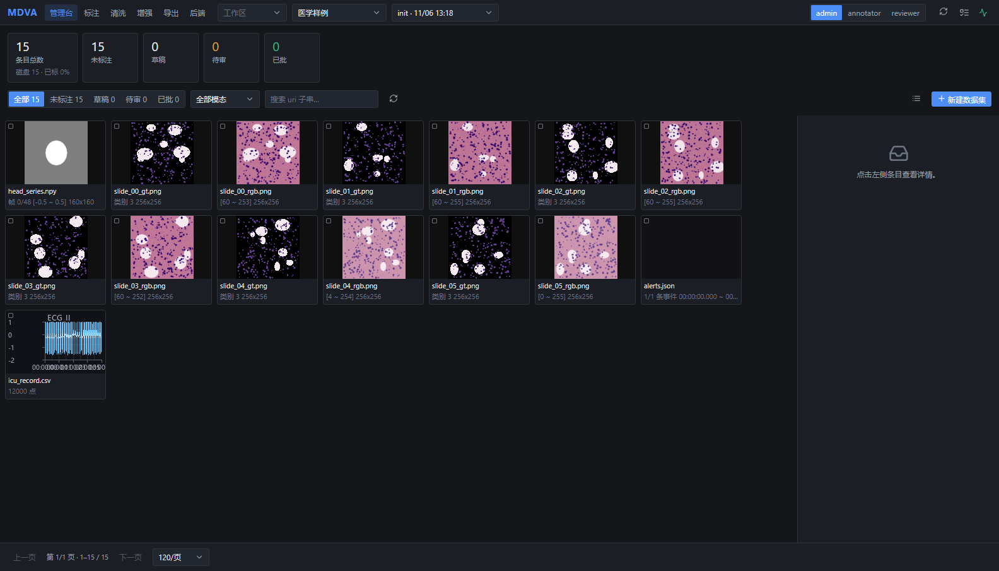
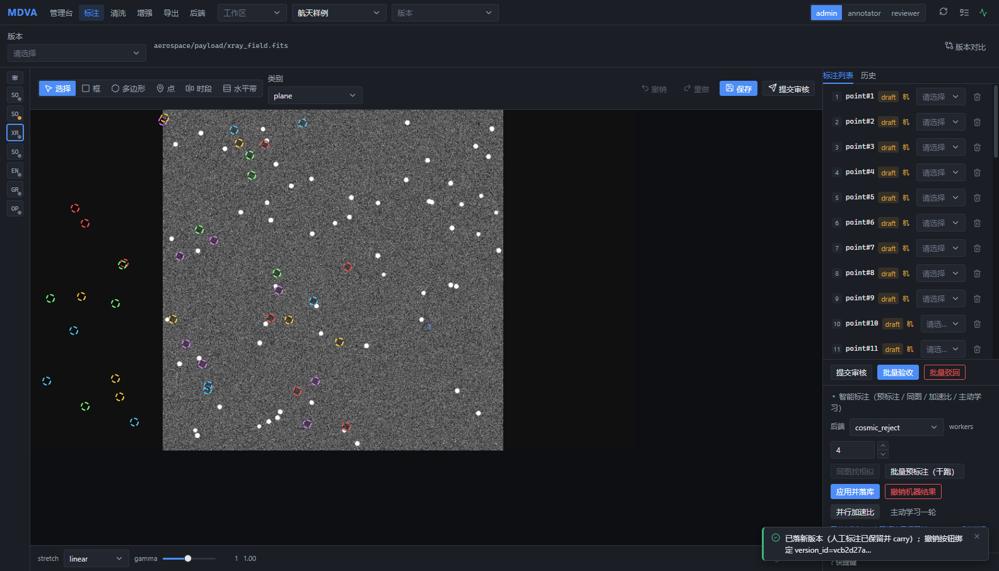
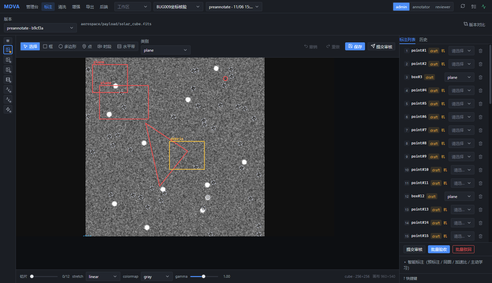
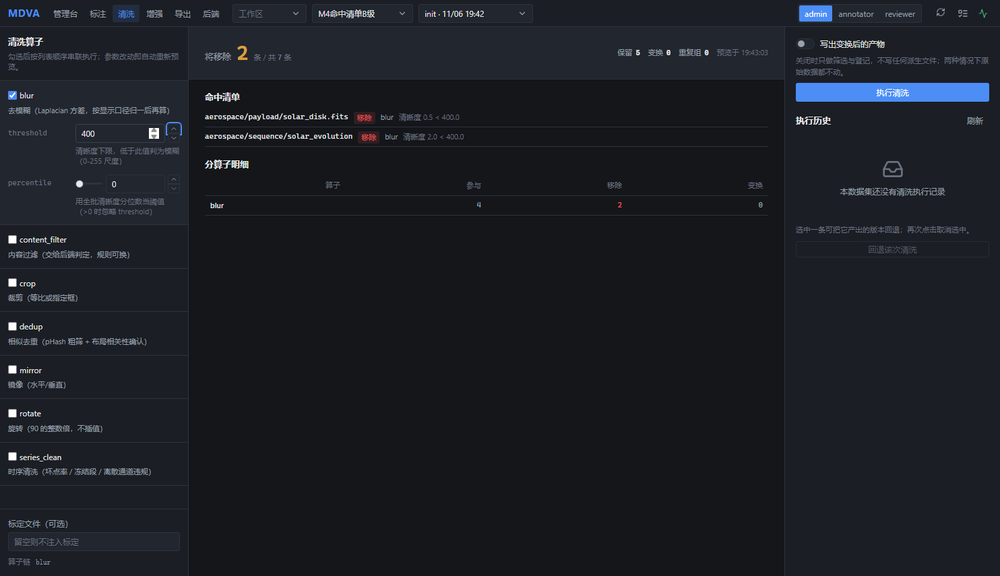
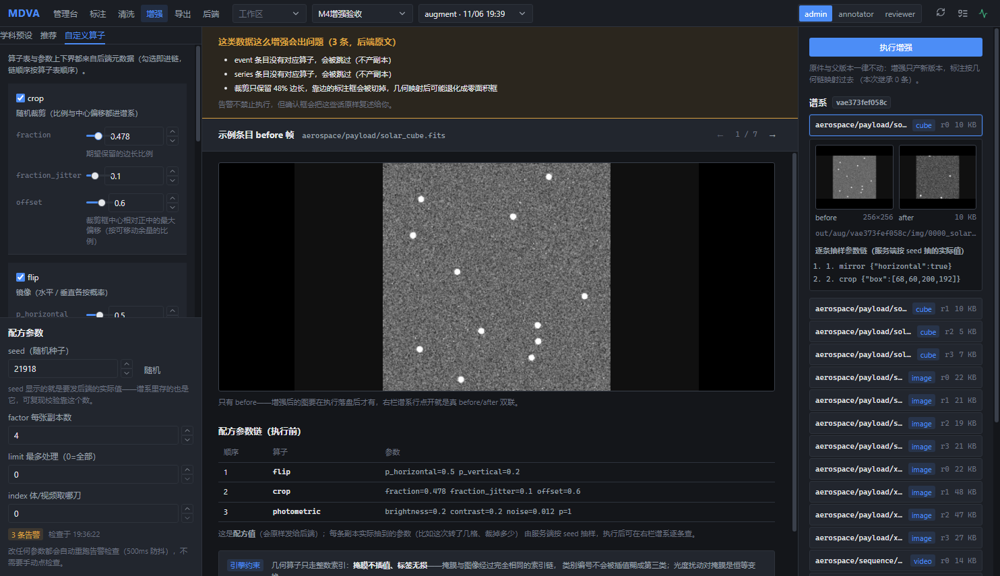

<div align="center">

# MDVA

**【开发中】面向太阳结构识别与数据整理的本地科研标注平台**
Localized Multi-modal Data Annotation & Augmentation Platform

完全离线 · 只绑 `127.0.0.1` · 数据不出机器 · 零出站请求

`开发中 / Work in progress` · `GPL-3.0` · `Python 3.10+` · `Vue 3 + TypeScript`

</div>

---

> 一份科研数据集，往往同时躺着 FITS 数据立方、病理切片、示波器时序、事件触发流和实验视频。
> 标注工具各管一种，脚本各写一套，清洗与增强在另一个仓库里，最后没人说得清这批数据是**谁、用什么参数、在哪一版**上产出的。
> MDVA 把这些环节收进**一个进程、一个 SQLite 真源、一条可追溯的版本链**，并且全程不联网。

---

## 开发状态与当前方向

**本项目正在开发中，尚未作为稳定版发布。** 当前重点是本地网页版的太阳结构识别、辅助自动标注、人工审核与数据整理，围绕活动区（AR）、冕洞（CH）和日面暗条（FL）完善工作流。当前范围不包含耀斑预测或空间天气预报。

太阳专用模型接入、公开基线复现与效果评估正在推进，尚未交付经过验证的太阳自动识别模型，也不宣称已获得原数据团队的模型权重。后文已有功能介绍、截图和测试数字属于此前开发记录，不代表当前版本已经完成全部验收；本地开发进度也可能尚未同步至默认分支。

## 数据集来源与下载说明

本项目当前开发与验证使用 **Solar Situation Awareness and Flare Forecasting Dataset for Operational Applications**（太阳态势感知与耀斑预报数据集）。

- 数据发布平台：Science Data Bank（科学数据银行）。
- 数据集 DOI：[10.57760/sciencedb.space.03541](https://doi.org/10.57760/sciencedb.space.03541)。
- 数据下载：[官方数据文件页面](https://www.scidb.cn/file?fid=951e66409424e2088f2f42562abf0e3a&mode=front)。
- 配套论文：[*Solar Situation Awareness and Flare Forecasting Dataset for Operational Applications*，Scientific Data](https://doi.org/10.1038/s41597-026-08005-5)。

**本 GitHub 仓库及其源码 ZIP 不包含上述太阳数据集的原始数据。** 请从官方页面自行下载、解压，再在本地配置数据目录；克隆仓库不会同时获得太阳观测图像、原始 NPY 掩膜、NOAA 对应表或耀斑事件表。仓库内已有的 `data/` 演示与测试样本不等于该完整太阳数据集。

原始数据包含 `Situation Awareness Dataset`、`Standardized Solar Observation Image Dataset` 和 `Solar Flare Forecasting Dataset` 等部分。数据集名称包含“耀斑预报”，并不意味着本项目当前提供预测功能；当前开发重点是结构识别、标注与整理。

数据集由原团队发布，本项目为独立开发的应用平台，并非原数据团队的官方软件。使用或再分发数据时须遵守官方数据页面的许可与引用要求；本仓库的 GPL-3.0 软件许可不替代数据集许可。请在使用本平台开展研究时分别引用软件、原始数据集与数据论文。

---

## 目录

1. [它解决什么问题](#1-它解决什么问题)
2. [三条不可协商的承诺](#2-三条不可协商的承诺)
3. [效果图](#3-效果图)
4. [功能全景](#4-功能全景)
5. [创新点与价值](#5-创新点与价值)
6. [实测数据](#6-实测数据)
7. [快速开始](#7-快速开始)
8. [架构](#8-架构)
9. [接口一览](#9-接口一览)
10. [技术选型与理由](#10-技术选型与理由)
11. [安全与使用边界](#11-安全与使用边界)
12. [已知限制](#12-已知限制)
13. [质量保障体系](#13-质量保障体系)
14. [路线图](#14-路线图)
15. [开发指南](#15-开发指南)
16. [引用与许可](#16-引用与许可)

---

## 1. 它解决什么问题

| 现状的断裂 | 具体表现 | MDVA 的处置 |
|---|---|---|
| **模态割裂** | 天文/医学/工程数据同时包含图像、数据立方、时序、事件流、视频；主流标注工具只认其中一种，跨模态对齐靠人眼对时间戳 | 五种模态统一到一套数据模型，跨模态只靠一个参考时间 `t_ref`（UTC 秒）联动，画布上一条时间轴同时驱动所有通道 |
| **数据出域** | 云端标注平台把原始数据传到第三方，科研数据常涉密或受数据管理计划约束；断网即不可用 | 只绑 `127.0.0.1` 的本地服务，进程不发起任何出站请求，并由自动化测试双重把关（源码静态扫描 + socket 动态拦截） |
| **预览与执行两套代码** | 清洗/增强脚本"预览显示移除 12 条，实际执行删了 9 条"，因为预览估算与执行逻辑分别实现 | 预览与执行**共用同一条判定路径**，界面上的数字就是执行时的数字，逐条命中清单同形状返回 |
| **产物不可追溯** | 增强后的图是谁生成的、用了哪个配方和随机种子、参数是多少，全都散在脚本控制台输出里 | 每一次增强落库为一条**版本记录**（父版本 / 算子链 / 参数 / seed / 统计），谱系可展开、可复现校验 |
| **删错原件** | 清洗"回退"操作误删原始数据，或增强覆盖同名文件 | **原件永不删除**：所有派生产物登记在册，回退只回收登记且校验一致的产物，且每次操作只产生新版本 |

---

## 2. 三条不可协商的承诺

这三条不是宣传语，而是被测试与验收逐条钉住的行为边界：

1. **数据不出机器。** 服务只监听回环地址；`--host 0.0.0.0` 未显式带 `--allow-remote` 时直接拒绝启动；离线自检用例在运行时拦截 socket，任何出站尝试即失败。
2. **原件永不删除。** 清洗与增强的所有产物写入独立输出目录并登记；回退动作只作用于"登记在册且校验一致"的产物。界面全文不出现任何暗示会动到原始数据的表述，此条由自动化禁用词扫描保证。
3. **预览即执行。** 预览接口与执行接口共用同一条判定代码路径，返回同一形状的结果结构；界面上"将移除 N 条"的 N 与实际执行结果同源，不存在第二次计算。

---

## 3. 效果图

> 以下截图均为真实运行界面（本地服务 + 仓库内示例数据集），非设计稿、非示意图。

### 3.1 管理台：五种模态同屏可辨



同一数据集里混排着视频帧（`帧 0/48`）、病理切片图、分割掩膜（`类别 3 256x256`）、事件流（`1/1 条事件`）与遥测时序（`ECG_II`，`12000 点`）。缩略图由后端按各自模态的最优表征渲染，时序与事件直接在卡片里画出波形，不必点开才知道是什么。

### 3.2 标注画布 + 智能标注



FITS 载荷图像上的目标点标注，右侧列表逐条显示审核态（`draft` / 机器产出标记）。右下"智能标注"面板可直接调用算法后端（图中为 `cosmic_reject`）、指定并行 worker 数、先干跑再批量预标注、一键应用并落库、一键撤销机器结果，并支持加速比实测与主动学习一轮。底部为渲染参数条（stretch / gamma），左侧竖排是该数据立方的各通道切片。

### 3.3 人工标注与机器标注同坐标系混排



机器预标注应用后，人工绘制的框与机器产出的几何严格落在同一坐标系（native 图像像素），改变渲染尺寸或输出分辨率不发生漂移——这是"同一份标注在任意渲染参数下都指向同一图像位置"的实测结果。

### 3.4 清洗视图：预览即出逐条命中清单



勾选算子、拖动阈值滑块，500ms 防抖后自动重新预览：顶部"将移除 **2** 条 / 共 7 条"，命中清单逐条给出 `uri + 算子 + 原因 + 实测值`（图中 `清晰度 0.5 < 400.0`），分算子明细表分别列出参与/移除/变换条数。右侧执行历史可一键回退该次清洗。

### 3.5 增强视图：配方 → 告警 → 执行 → 谱系 → 复现校验



左栏算子表与配方参数（`seed`、`factor` 等，参数上下界由后端元数据驱动，界面不写死）；顶部橙色告警条**原样复述后端返回的告警**（哪些模态没有对应算子会被跳过、裁剪可能导致标注退化为零面积）；中央为 before 帧与执行前配方参数链；右栏谱系逐条列出每个版本，展开即真 `before / after` 双联图与服务端按 seed 抽样的**逐条实际参数值**。

---

## 4. 功能全景

### 4.1 统一多模态数据模型

| 模态 | 典型载体 | 渲染要点 | 可用几何 | 跨模态联动键 |
|---|---|---|---|---|
| `image` | PNG / JPEG / TIFF | stretch + gamma 实时调色 | box / poly / point / 水平带 | `t_ref` |
| `cube` | FITS 数据立方 | 切片索引 + 通道切换 | box / poly / point / 水平带 | `t_ref` + 切片索引 |
| `series` | CSV / npy 遥测时序 | 波形 + 时间轴刷选 | 时段（区间） | 时间区间 |
| `event` | JSON 事件流 | 事件刻度轨 | 时段 | 事件时间戳 |
| `video` | 帧序列 / mp4 | 帧索引 + 时间轴 | box / poly / point | `t_ref` + 帧号 |

数据接入只做一次探测（`/api/scan`），模态判定由文件头实测得出，不依赖扩展名；同一份判定函数同时服务列表与帧元数据两个接口，杜绝两处口径漂移。

### 4.2 标注内核

- **几何类型**：矩形框、多边形、点、时间区间、水平带；顶点级编辑与句柄拖拽。
- **审核状态机**：`draft → submitted → approved / rejected`，角色（admin / annotator / reviewer）越权操作被服务端拦截。
- **版本 DAG**：每次批量操作产生新版本节点，记录父版本、操作类型、参数与统计；任意两版可对比。
- **可回退**：画布编辑支持撤销/重做栈（含拖拽、缩放、顶点提交），未保存离开有拦截提示。

### 4.3 智能标注与算法后端

- **13 个后端**：9 个经典分析算子 + 1 个视觉提示（模板匹配）+ 3 个深度模型**占位实现**。
- **能力探测而非文档宣称**：每个后端自报支持的模态、任务、几何类型与参数 schema；界面按能力矩阵呈现可用性，不可用项显示原因。
- **实测表驱动的推荐**：后端推荐排序与准入门槛由基准实测数据（`out/bench/backends.json`）决定，而不是写死在代码里。
- **批量与并行**：干跑预览 → 批量预标注 → 应用并落库 → 撤销机器结果，全链路可在界面完成；并行加速比可实测出数。
- **主动学习**：后端提供不确定性估计，`/api/smart/active_round` 挑出"最值得人看"的条目。
- **深度后端诚实占位**：不下载、不内置任何模型权重，`available()` 恒为 False 并说明原因，不参与推荐排序。全部可用后端在 CPU 上运行，零显存依赖。

### 4.4 数据清洗

算子：模糊剔除（`blur`）、内容过滤（`content_filter`）、裁剪（`crop`）、相似去重（`dedup`，pHash 粗筛 + 布局相关性确认）、镜像/旋转、时序清洗（`series_clean`：坏点率 / 冻结段 / 离散通道违规）。

关键行为：勾选即串联、参数改动自动重预览、命中清单逐条可查、执行后新版本自动切换、回退即时反映且无需刷新页面。

### 4.5 数据增强

- **配方（recipe）**：算子链顺序即语义（`flip→rotate90` 与 `rotate90→flip` 不等价），界面按配方原始顺序下发，不自作主张排序。
- **seed 谱系**：每次执行记录 seed 与每条副本的实际抽样值，落库可查。
- **执行前强制告警检查**：未跑告警检查则执行按钮禁用；告警文案原样复述后端返回，不改写。
- **复现校验**：对谱系做**参数链逐条一致**校验，逐条列出差异（`{uri, why}`）。像素级一致性由渲染确定性另行保证，不在该断言范围内——界面与文档都不做超出引擎实际能力的承诺。
- **几何算子约束明示**：几何变换只走整数索引，掩膜不插值、标签无损；光度扰动对掩膜是恒等变换。

### 4.6 导出与训练就绪

四种格式：COCO / YOLO / VOC / 多模态 JSON。支持训练/验证/测试划分比例，导出后**回读校验**（重新解析产物核对条数与几何），并随产物生成可离线运行的 `train.py` 与 `DATASET.md`。

### 4.7 双入口：Web 与 CLI

- **Web 六视图**：管理台 / 标注画布 / 清洗 / 增强 / 导出 / 后端算法。
- **CLI 14 个子命令**：`datasets` `scan` `render` `mosaic` `analyze` `timeaxis` `batch` `speedup` `clean` `augment` `export` `validate` `bench` `serve`。适合跑批、复现实验与无界面环境。

---

## 5. 创新点与价值

### C1 — 预览与执行共用一条代码路径

- **问题**：清洗/增强工具普遍把"预览"实现为一次独立估算，与真正执行是两套逻辑，数字对不上时用户只能盲试。
- **做法**：预览接口直接调用执行侧的判定函数，返回同一形状的结果结构；界面显示的数字与逐条清单都来自这一次判定。
- **价值**：把"我到底会去掉多少条"从猜测变成可核对的事实；答辩与评审场景下，预览数字与执行结果同源是能被当场验证的，而不是设计说明。
- **证据**：独立复验中，界面显示值 = 同参数直连重放值 = 执行后实际条数（三处同为 2）。

### C2 — 文件指纹 LRU：把"每次请求全量重解析"变成一次冷启动

- **问题**：多模态文件（尤其 FITS 立方与长时序）解析昂贵，滑块每动一下都重新解析全部条目，实测单次预览约 **6.99 秒**，交互完全不可用。
- **做法**：以 `uri + 文件大小 + mtime_ns` 为键的 LRU 缓存挂在统一加载入口上，所有需要逐条读取数据的接口共用这一条链路；缓存语义、失效判定与错误口径保持不变。
- **价值**：交互从"改一个参数等 6 秒"变成"首帧冷加载、后续即时"，现场演示的拖动联动才成立。
- **证据**：清洗预览 冷 **6.99s** → 热 **0.01s**；增强告警检查 冷 **6139ms** → 热 **0ms**、改参数尾沿 **0ms**。两处均有回归用例钉住"走缓存入口而非逐条重解析"，并有 `touch` 单文件只重解析该条的失效验证。

### C3 — 只产新版本、原件永不删除的回退语义

- **问题**：数据清洗的"撤销"通常意味着删除文件，一旦登记与实际产物不一致就会误删原始数据。
- **做法**：所有派生产物写入独立输出目录并登记在册；回退只回收"登记且校验一致"的产物，校验不一致则拒绝并说明；界面与文档统一使用"原件不动"的表述。
- **价值**：把最危险的一类操作变成可反复试验的低成本操作，这是科研数据工具能否被真实使用的底线。
- **证据**：回退后版本与条目即时反映、无需刷新；对话框复述登记语义；禁用词扫描保证界面不出现任何暗示会动到原始数据的表述。

### C4 — 统一坐标系：人工标注与机器标注真正可混排

- **问题**：标注坐标常被存成"画布像素"，一旦渲染尺寸、输出分辨率或适配缩放变化，标注就会相对图像漂移；同一字段里混着人工与机器两套坐标系，reload 自测却看不出问题。
- **做法**：所有几何统一存 **native 图像像素**，渲染时经统一的 `fit` 映射换算；叠加层、保存回写、命中检测共用同一映射。
- **价值**：标注成为与渲染参数无关的数据资产；机器预标注应用后与人工标注可同屏混排而不错位。
- **证据**：跨 3 组输出尺寸（1280×720 / 480×800 / 640×360）反解漂移 **0.0px**；保存后 reload 逐顶点一致；apply 后人工/机器混排零越界。

### C5 — 手势完整性作为验收断言，而不是"能点即通过"

- **问题**：画布类交互最容易假绿——自动化脚本用"单段大跳"模拟拖拽永远通过，真人连续小幅拖拽却被浏览器原生拖拽事件劫持，图形卡在半路。
- **做法**：把验收口径写成**多段连续手势**断言：事件族中不得出现 `dragstart`、`mouseup` 必须送达、不得残留拖拽态、跟随比 ≥ 0.9，并对四类手势（多边形顶点 / 框句柄 / 框本体 / 点本体）分别断言。
- **价值**：把"自测通过但真人操作失败"这一类缺陷在合入前拦住。
- **证据**：修复前跟随比 ≈0.21、`mouseup` 不派发、100% 复现；修复后跟随比 **0.974**、`dragstart=0`、`mouseup=1`、无残留态。

### C6 — Web 层零新增依赖

- **问题**：本地工具一旦引入 Web 框架，就带来一整套运行时依赖、版本冲突与部署步骤，而目标用户只是想"双击就能跑"。
- **做法**：HTTP 服务用 Python 标准库 `http.server` 实现（线程化服务器 + 自研路由表），63 个接口一次调用对应一个界面动作；前端构建产物由后端直接静态托管。
- **价值**：`pip install -e .` 之后没有任何服务端依赖需要装；离线环境、教学机房、评审机都能直接跑起来。
- **证据**：接口层测试与断网自检用例全绿；服务启动仅依赖引擎已有的科学计算栈。

### C7 — 不做超出能力的承诺（措辞也是被测对象）

- **问题**：文档与界面里的"绝对一致""完全相同"这类过度承诺，会在评审时被追问到无法自证，也是内部误解的来源。
- **做法**：红线措辞纳入自动化**禁用词扫描**，扫描范围覆盖界面与对外文档；引擎实际校验什么，界面就说什么（此处为"参数链逐条一致"）。
- **价值**：对外表述与内部断言严格对齐，任何一条承诺都能指到一条用例或一份实测数据。

---

## 6. 实测数据

| 指标 | 数值 | 说明 |
|---|---|---|
| 自动化测试 | **617 passed / 18 skipped** | 全量套件，单条约 100s |
| 引擎代码规模 | **16,357 行**（`src/mdva`） | 不含上游遗留与前端 |
| 测试代码规模 | **7,651 行** | 含服务层、引擎层与断网自检 |
| HTTP 接口 | **63 个**（方法+路径注册项） | 标准库实现，零新增依赖 |
| CLI 子命令 | **14 个** | 与接口层共用同一套服务 |
| 算法后端 | **13 个** | 9 经典 + 1 视觉提示 + 3 深度占位 |
| 清洗预览时延 | 冷 **6.99s** → 热 **0.01s** | 7 路演示数据集，真实 Hub |
| 增强检查时延 | 冷 **6139ms** → 热 **0ms** | 同参第二次与改参尾沿均为 0ms |
| 标注坐标漂移 | **0.0px**（跨 3 组输出尺寸） | native 像素 + `fit` 反解核对 |
| 拖拽跟随比 | **0.974** | 多段连续手势，修复前 ≈0.21 |
| 出站请求 | **0** | 源码静态扫描 + socket 动态拦截 |
| 示例数据集 | 航天 **7** 路 / 医学 **15** 路 / CV 分割 **60** 路 | 均带 `truth.json` 供评测 |

---

## 7. 快速开始

### 7.1 环境

Python 3.10+。推荐 conda：

```bash
conda env create -f environment.yml
conda activate mdva
```

Windows 可一键：`install.bat`（自动检测 conda，建环境或退回当前 Python）。

### 7.2 安装引擎

```bash
git clone https://github.com/JingYuXu-experts/MDVA-Label.git
cd MDVA-Label
pip install -e .
```

版本号由 `setuptools_scm` 从 git 标签生成，因此需要 git。

### 7.3 构建 Web 界面（可选）

```bash
cd frontend
npm install
npm run build      # 产物输出到 src/mdva/web/static
```

未构建时首页显示构建指引说明页，不影响 CLI 与接口使用。

### 7.4 启动

```bash
python -m mdva serve --data ./data --db ./out/mdva.db --out ./out --open
# 浏览器打开 http://127.0.0.1:8765
```

免安装直接跑（把 `src/` 加进路径）：`python main.py` 或 `run.bat`。

### 7.5 CLI 示例

```bash
mdva scan data/aerospace                          # 只读文件头，探测模态与结构
mdva analyze data/aerospace --draw                # 跑全部体检算子并输出叠加图与 JSON 报告
mdva clean --data ./data --preview --ops "blur:threshold=400,dedup"     # 预览：只算不写
mdva clean --data ./data --ops "blur:threshold=400"                     # 执行：只产新版本
mdva augment --data ./data --preset cv_segmentation --seed 21918 --factor 4
mdva export --data ./data --format coco --split 0.7/0.2/0.1 --scripts --verify
mdva bench data --limit 4                         # 生成后端实测表 out/bench/backends.json
```

---

## 8. 架构

```
┌──────────────────────────────────────────────────────────────┐
│  Web 界面  Vue 3 + TypeScript + Pinia（构建产物由后端托管）    │
│  管理台 · 标注画布 · 清洗 · 增强 · 导出 · 后端算法              │
├──────────────────────────────────────────────────────────────┤
│  本地服务  标准库 http.server（ThreadingHTTPServer）           │
│  路由表 · 传输层/服务层分层 · 错误体统一 · 长任务同步阻塞        │
├──────────────────────────────────────────────────────────────┤
│  引擎六层  src/mdva                                            │
│  io（多模态接入 + 文件指纹 LRU）                                │
│  render（stretch/gamma/切片/马赛克/时间轴）                     │
│  analysis（体检算子 + 标记 + 度量）                             │
│  annotate（几何 + 审核状态机 + 版本 DAG + 传播）                │
│  clean / augment（预览=执行同路径 · seed 谱系 · 复现校验）      │
│  export（COCO/YOLO/VOC/多模态 JSON + 回读校验 + train.py）      │
├──────────────────────────────────────────────────────────────┤
│  backends  能力探测 · 实测表推荐排序 · 准入门槛 · 深度占位       │
│  core      SQLite 单一真源 · uri 相对工作区根 · schema 迁移     │
└──────────────────────────────────────────────────────────────┘
```

目录结构（以仓库实际内容为准）：

```
src/mdva/            引擎与本地服务（六层 + backends + core + web + cli）
frontend/            Vue 3 前端源码，构建产物入 src/mdva/web/static
tests/mdva/          全量测试（引擎 / 服务 / 接口 / 断网自检）
data/                三分学科示例数据集（带 truth.json）
out/                 运行产物：增强副本、导出包、bench 实测表
assets/              桌面入口文件与文档截图
experiments/         实验固化脚本（路线图项，见第 14 节）
```

---

## 9. 接口一览

63 个注册接口按域分组。设计原则：**一次调用 = 一个界面动作**，不做前端轮询式拼装。

| 域 | 接口 |
|---|---|
| 工作区与数据集 | `GET /workspaces`、`POST /workspaces/rescan`、`GET/POST /datasets`、`GET /dataset`、`GET /manifest`、`GET /health` |
| 探测与条目 | `GET /scan`、`GET /items`、`GET /thumbs`、`GET /mosaic`、`GET /probe` |
| 帧与渲染 | `GET /frame`、`GET /frame/meta` |
| 标注 | `GET/POST /annotations`、`POST /annotations/submit`、`POST /annotations/review`、`POST /annotations/state`、`POST /labels`、`GET /lineage`、`GET /versions`、`GET /diff`、`GET /review_log` |
| 智能标注 | `POST /smart/preannotate`、`POST /smart/apply`、`POST /smart/undo`、`POST /smart/same_image`、`POST /smart/active_round`、`POST /smart/active_run`、`GET /smart/hard`、`GET /smart/history`、`GET /smart/speedup` |
| 后端与算子 | `GET /backends`、`GET /operators`、`GET /recommend`、`GET /gate`、`GET/POST /bench` |
| 分析 | `POST /analyze`、`GET /stats` |
| 清洗 | `GET/POST /clean/preview`、`POST /clean/apply`、`POST /clean/rollback`、`GET /clean/dropped`、`POST /collect`、`GET /collect/latest`、`POST /collect/undo` |
| 增强 | `GET /augment/recipes`、`POST /augment/suggest`、`POST /augment/check`、`POST /augment/run`、`GET /augment/lineage`、`POST /augment/replay` |
| 导出 | `POST /export`、`GET /export/formats`、`GET /export/report`、`POST /export/validate` |
| 任务与版本 | `GET /tasks`、`GET /progress`、`GET /queue`、`POST /version` |

约定要点：错误响应体统一为 `{error, path, method}`；分钟级长任务为同步阻塞端点，前端做按钮 loading + 长超时 + 可取消；`/api/tasks` 是落库留痕清单而非进度源；`uri` 为相对工作区根的 posix 路径，接口只认工作区名字、不认任意路径。

---

## 10. 技术选型与理由

| 选择 | 理由 |
|---|---|
| 存储用 **SQLite**（单文件） | 单机单用户场景下，事务、索引、并发读足够；无需任何服务型数据库；数据即一个文件，便于随数据集一起交付与归档 |
| 服务端用**标准库 http.server** | 见 C6：零新增依赖是硬要求，部署路径最短 |
| 前端用 **Vue 3 + TS + Pinia** | 六视图共享状态多（工作区/数据集/版本/选中条目），组合式 API + 显式 store 比临时全局对象更可测 |
| 渲染参数**服务端出图** | FITS/长时序解析必须在后端；浏览器直出 `` 可复用浏览器缓存，拖时间轴不重复解码 |
| 深度模型接入**开发中** | 已有深度后端仍为占位；后续依据公开论文、代码和可复现基线开展本地模型接入，权重另行获取或训练，不随源码分发 |
| 版本由 **setuptools_scm** 生成 | 避免代码里手写版本号与 git 标签漂移 |

---

## 11. 安全与使用边界

- **仅限本机单用户使用。** 服务绑定 `127.0.0.1`；显式对外监听需同时提供 `--allow-remote`。
- **完全离线。** 进程不发起任何出站请求，由 `test_offline` 静态扫描源码 + 动态拦截 socket 双重把关。
- **路径安全。** 接口只接受工作区名字与相对工作区根的 `uri`，不接受任意路径输入，杜绝路径穿越。
- **长任务可控。** 分钟级端点提供取消路径，任务留痕落库。
- 本项目定位为**个人/课题组本地工具**，不提供多用户并发、权限体系或服务化部署；这类需求请评估其他方案。

---

## 12. 已知限制

诚实列出，避免评审现场被追问：

1. **深度模型后端为占位实现**，不内置权重，`available()` 恒为 False 并说明原因；开集检测能力目前由视觉提示（模板匹配）覆盖。
2. **单用户、单机**。无账号体系、无跨机同步；工作区之间相互隔离。
3. **主动学习与推荐的效果依赖数据集分布**，示例数据集仅用于演示与回归，不代表任何真实科研结论。
4. **导出格式覆盖**当前为 COCO / YOLO / VOC / 多模态 JSON 四类；其他格式需自行扩展导出器。
5. **跨浏览器验证以 Chromium 为主**，其他内核的手势行为在批次验证中补充覆盖。

---

## 13. 质量保障体系

| 层次 | 做法 |
|---|---|
| 引擎与服务测试 | 617 条用例覆盖六层引擎、63 个接口、错误体与长任务路径 |
| 断网自检 | 静态扫描源码中的网络调用 + 运行时 socket 拦截 |
| 独立复验 | 验收方**不复用**开发方脚本，自建断言集；UI 断言先核对构建产物哈希，防止"测的是旧包" |
| 坐标与手势断言 | DOM 属性级反解（而非截图比对）、多段连续手势、事件族检查、跟随比阈值 |
| 措辞红线扫描 | 对界面与对外文档做禁用词扫描，杜绝超出引擎实际能力的表述 |
| 数据诚实 | 功能未达数据可得性时，界面显式标注中间态而非填假数据 |

运行测试：

```bash
pip install -e .[dev]
pytest                       # 全量
pytest tests/mdva/test_offline.py -q     # 断网自检
```

---

## 14. 路线图

| 阶段 | 内容 | 状态 |
|---|---|---|
| 引擎六层 + 本地服务 | 多模态接入 / 渲染 / 分析 / 标注 / 清洗 / 增强 / 导出 + 63 接口 | 已完成 |
| Web 管理台 · 标注画布 · 清洗视图 | 含智能标注、审核状态机、逐条命中清单 | 已完成并独立复验 |
| Web 增强视图 | 配方 → 告警 → 执行 → 谱系 → 复现校验 | 已交付，复验中 |
| Web 导出视图 · 后端算法视图 | 导出回读校验展示、能力矩阵与实测表展示 | 开发中 |
| 本机 token 鉴权 | 启动时随机 token，防同机其他进程读取 | 待与后端视图联调 |
| 实验固化脚本 `experiments/` | 六组实验（接入/渲染/分析/清洗/增强/导出）一键复现 | 计划中 |
| 全流程断网演示与交付包 | 含真鼠标与跨浏览器补测轮 | 计划中 |

---

## 15. 开发指南

```bash
# 前端
cd frontend && npm install
npm run typecheck && npm run lint && npm run build

# 后端（不装包也能跑）
set PYTHONPATH=src && pytest tests/mdva -q
```

- 提交信息用祈使句说明"为什么"，行为变更必须带回归用例。
- 缓存类改动先验证被缓存对象的**只读语义**，再接缓存。
- 界面文案改动需同步检查是否触碰措辞红线；新增数据展示前先确认数据是否真的可得。

---

## 16. 引用与许可

- **许可**：GPL-3.0，详见 [LICENSE](LICENSE)。
- **引用**：`CITATION.cff`（Xu Jingyu，*MDVA：本地化多模态科研标注平台*，v0.1.0）。
- **版本变更**：见 [CHANGELOG.md](CHANGELOG.md)。

```bibtex
@software{mdva_2026,
  author = {Xu, Jingyu},
  title  = {MDVA：本地化多模态科研标注平台},
  url    = {https://github.com/JingYuXu-experts/MDVA-Label},
  version = {0.1.0},
  license = {GPL-3.0}
}
```
