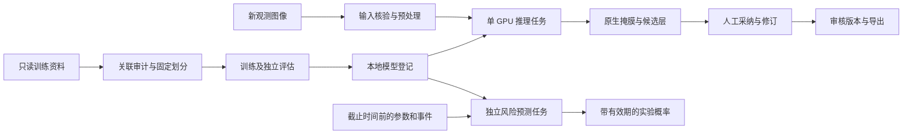

> 2026-11-15执行更新：用户已授权修订计划，M1通过，受限训练运行中。当前入口与实际结果见[工程验收与运行记录](修订训练-工程验收与运行记录-20261115.md)；下方待验收文字是历史快照。

> 当前为诊断后修订计划待用户验收，训练保持停止。请先读[20261115-R1修订计划与验收](模型训练-诊断后修订计划与验收-20261115.md)和[M0—M6接续总账](模型训练-M0至M6实施与接续总账-20261112.md)。以下保留原始设计与早期预算，不能作为当前自动恢复依据。

# MDVA 本地识别、自动标注与预测模型：完整开发计划

> 2026-11-12 准备阶段更新：已按用户要求使用现有 Conda `mdva311` 完成模型环境及训练数据准备，未开始正式训练。实际覆盖检查后，CH/FL 的验证期改为 2019–2020 年；AR 与参数预测保留原时间协议。最新执行状态、使用入口和验收结果见[训练前准备记录](训练前准备-环境与数据验收-20261112.md)。下文保留原始计划语境。

日期：2026-11-12。用途：供项目负责人审阅、安排开发与训练。本文是实施计划，不是训练结果或精度承诺。本轮只做资料核验和计划编写，未修改应用代码、安装模型环境、加载模型或启动训练。

本计划覆盖此前讨论中的模型接入部分，替代 2026-11-07 文档中未经基线核验的架构定案，以及 2026-11-08 文档中“不开展预测”的旧范围。此前已确认的原始数据只读、本地运行、人工复核和不自动推送 GitHub 等要求继续有效。

## 一、产品目标与模型选型

### 1.1 最终用户能做什么

用户导入符合输入条件的太阳图像，即使没有掩膜和坐标，也能让平台识别实际太阳结构的位置，获得可编辑的候选标注。历史训练使用已有图像和标签；实际推理不要求用户提供标签。

| 功能 | 输入 | 平台输出 | 在产品中的位置 |
|---|---|---|---|
| AR 活动区识别 | 经过适配的 HMI 视向磁图 | 活动区区域、对象候选、派生框；可核验时关联 NOAA 编号 | 太阳观测、标注工作台 |
| CH 冕洞识别 | 经过适配的 AIA 193 Å 图像 | 冕洞区域及边界 | 太阳观测、标注工作台 |
| FL 日面暗条识别 | 经过台站适配的 Hα 图像 | 暗条区域及边界 | 太阳观测、标注工作台 |
| 自动标注 | 上述图像和对应领域模型 | 机器候选层、批量草稿版本、来源和质量信息 | 标注工作台 |
| 点击/框选辅助 | 图像、用户指定的类别与点/框提示 | 用户指定对象的候选边界 | 标注画布 |
| 活动区耀斑风险预测 | 截止时刻前可获得的活动区参数及历史事件 | 某活动区未来 24 小时发生 M 级及以上耀斑的概率 | 工作台、监测台实验预测卡片 |
| 图像直接预测对照 | 符合训练协议的 HMI 全日面磁图 | 独立定义的全日面未来 24 小时 M+ 耀斑风险 | 后续实验预测卡片 |

AR 是活动区，不等同于太阳黑子；FL 是 filament（日面暗条），不是 flare（耀斑）。训练的区域标签对应这些真实太阳结构，不用太阳圆盘区域替代活动结构标注。CH/FL 的二值标签表达“哪些像素属于这类结构”，并非已经提供每个物理对象的独立身份。

预测先限定为 **24 小时 M+ 耀斑风险**。它与“某次 CME 何时到地球”“未来 Kp”“某条通信链路中断概率”是不同任务。三天机构预报、CME 分析和传播产品继续用已有权威信源；自研耀斑概率不自动生成地磁暴等级、到达倒计时或三维冲击波。

### 1.2 建议采用的本地方案

选型依据是任务与标签是否匹配、是否存在论文和作者实现、8 GB 显存能否维护、能否独立验证。下表定的是**首轮实际执行的候选顺序**；最终部署版本由同协议实验决定，不预先宣布哪一个精度最好。

| 任务 | 首轮主线 | 必须比较的基线 | 当前选择理由 |
|---|---|---|---|
| AR 区域与对象 | 单通道标准 U-Net，初始通道 32；另接对象分组模块 | 原团队已公开描述的标注细化规则、简单阈值/形态学；对象层比较连通域与 IATools 的分组规则重建 | 利用现有栅格监督，以较小资源先建立可测链路。U-Net 在 AR 上属于本项目任务适配，不能称 SPNet 复现 |
| CH 区域 | CNN193 的 U-Net 方法，做现代 PyTorch 独立重建与 SSAFD 适配 | 同输入的阈值/区域生长；条件允许时核对原 TensorFlow 实现 | 有明确的太阳 AIA193 分割论文和作者源码；现有单通道数据适配成本低 |
| FL 区域 | **Flat U-Net，32 通道，先采用作者配置 SCA4+CSA1** | DeepFilamentSegmentation 的单通道 U-Net；简单暗结构提取 | 作者公开代码、配置和权重，目标正是全日面 Hα 暗条分割，模型较小 |
| 提示式辅助标注 | **SAM 2.1 Hiera Tiny**，不作为太阳类别识别器 | 手工多边形；必要时同批对照 Small | 有官方本地权重和点/框接口，负责用户选定对象的边界辅助 |
| 活动区预测 | **经过独立概率校准的 SVM** | 气候概率、逻辑回归、上一时段持续性；条件满足后比较日采样 LSTM | 直接使用现有参数表，成本小，亦与原团队研究中的参数 SVM 对照路线相符 |
| 图像预测扩展 | **AlexNet 首先复现输入/训练链路，ResNet34 对照** | 全日面气候概率、持续性基线 | 已定位使用全日面磁图预测未来 24 小时 M+ 的论文；原研究是小时采样，本地日采样必须单独适配与评价 |

AR 对象分组若无法达到可用水平，再增加 **Mask R-CNN ResNet50-FPN** 的实例分割对照。它直接利用 AR 每实例掩膜，但更占资源，低分辨率 ROI 掩膜也可能损失边界；不能仅因通用检测器热门就替换主线。是否推进由 AR 的误合并/误拆分结果决定。[Torchvision 标准接口](https://docs.pytorch.org/vision/stable/models/generated/torchvision.models.detection.maskrcnn_resnet50_fpn.html)

首轮不同时引入 YOLO、GroundingDINO、YOLO-World 等一整套通用识别器；框可以从已验证的分割结果派生。也不在本机从头预训练 SPNet/FPNet 那样的多模态基础模型。

### 1.3 论文与实现核验结论

1. **数据论文与原团队模型论文分开使用。** SSAFD 数据论文提供标签构建、参数与预处理依据；SA-AI Forecaster 论文介绍 SPNet、IATools 和 FPNet。后者采用 Transformer/多模态路线，本次没有核验到可直接安装的官方完整训练实现和权重，不能承诺“拿来即用”。两项工作的数据 DOI 也不同，不直接认定训练划分相同。[数据论文](https://doi.org/10.1038/s41597-026-08005-5)、[SA-AI Forecaster](https://arxiv.org/html/2508.06892v1)
2. **CNN193 已定位作者原版。** 仓库 `mnras2018` 分支有原始模型和训练笔记，使用旧 TensorFlow。原仓库当前未发现明确的许可证声明，不能默认复制再分发；优先根据公开论文独立重建方法，记录与原实现的差异。[论文](https://arxiv.org/abs/1809.05748)、[原版源码](https://github.com/observethesun/coronal_holes/tree/mnras2018)
3. **Flat U-Net 不再只是文献候选。** 已下载作者 Zenodo 发布包用于只读核查，校验发布方 MD5；包内有源码、配置、MIT 许可和 11 个 `.pth` 文件。尚未加载这些权重、验证推理或确认它们与本地测试集没有重叠。作者默认配置包含 512×512、32 通道和 SCA4+CSA1；其 FITS 预处理不能直接原样套在现有 JPG 上。[论文](https://arxiv.org/abs/2502.07259)、[作者发布包](https://zenodo.org/records/14610155)
4. **DeepFilamentSegmentation 已核查训练源码。** 使用单通道 U-Net；原研究先用 YOLOv5 产生辅助训练标签。我们已有像素标签，首轮直接做监督适配，不必先重做其全部半监督数据生成过程。改变监督来源须写进实验说明。[论文](https://arxiv.org/abs/2402.15407)、[作者实现](https://github.com/adiercke/DeepFilamentSegmentation)
5. **LSTM 是已有公开研究基线，但不是数据团队随包交付的模型。** 数据论文引言引用 Liu 等人的 LSTM 工作；该研究使用 SHARP 参数和耀斑历史。已定位作者关联实现及 MIT 许可，但其输入与本地日采样 LoS 参数不同，现成权重不能直接套用。[论文](https://arxiv.org/abs/1905.07095)、[关联实现](https://github.com/ccsc-tools/LSTM-flare-prediction)
6. **图像预测有可追溯研究依据。** Pandey 等人比较了 AlexNet、VGG16、ResNet34；首轮保留较小的 AlexNet 和有对照价值的 ResNet34。论文给出 Bitbucket 代码地址，本次访问未成功，状态为“已定位、尚未核验实现”。[论文](https://arxiv.org/abs/2309.14483)、[论文给出的代码地址](https://bitbucket.org/gsudmlab/fulldisk-spatial-analytics/src/main/)

CHRONNOS 保留为后续多通道对照。作者实现要求的完整通道/标定输入与当前四种 AIA JPG 不是同一输入配置；缺少的通道不以零值或复制图片凑齐。[作者实现](https://github.com/RobertJaro/MultiChannelCHDetection)

## 二、已有数据、硬件与训练准备

### 2.1 本地数据复核

以下是 2026-11-12 对用户已有目录的读取结果，不需要重新下载原数据包。

| 结构 | 图像 | 掩膜 | 同名配对 | 无掩膜图像 | 无图像掩膜 |
|---|---:|---:|---:|---:|---:|
| AR | 5,092 | 4,308 | 4,308 | 784 | 0 |
| CH | 3,831 | 3,824 | 3,813 | 18 | 11 |
| FL | 4,625 | 3,836 | 3,793 | 832 | 43 |
| 合计 | **13,548** | **11,968** | **11,914** | **1,634** | **54** |

抽查 AR 图像/掩膜为 1024×1024，AR 掩膜为整数实例编码；CH/FL 抽查为 512×512、0/1 类别区域。完整训练前仍需逐文件核验尺寸、取值与损坏，不把抽查当作全量语义验收。

标准化观测目录另有 **46,328 个图像文件**，包括 AIA 131/193/211/304、EIT 195/304、Hα、连续谱、HMI/MDI 磁图。这里的文件数不能与 13,548 直接相加当作独立样本，需要识别重收录、同一观测不同缩放和同日多时刻。

预测资料包括：

- 4,288 份活动区参数 TXT，实际共 **21,232 条原始活动区日记录**，原始非空 NOAA 字段有 2,462 个不同取值。最终训练样本数还要扣除关联、缺测、时间及划分问题。
- 4,308 份活动区耀斑指数图，以及 C+、M+、X 三组各 4,308 份标签图；它们是按活动区涂入图像的监督资料，不是数百万个独立像素预测样本。
- `flare list.xlsx`，已有清点为 23,566 条非空事件记录，包含日期、起始/峰值/结束时间、等级和 NOAA 编号。
- `Code` 只有 AIA、连续谱、Hα、磁图四份预处理脚本，与数据论文的 Code Availability 说明一致，没有随包的 SPNet/FPNet 训练代码。

参数字段为 `Num, NOAA_AR, MGB_PIL, R, MGB, Total_Unsigned_Flux, Area, Hale, McIntosh`。本次统计发现：Hale 和 McIntosh 各缺失 **6,271 条，约 29.5%**；MGB 与 MGB_PIL 各有 5 条空值。NOAA_AR 与 Num 只用于关联，不能作为数值输入让模型记住区域身份。

### 2.2 必须在训练前解决的关联问题

1. 以图像源、原始观测时间、产品、实例编号、NOAA 编号建立样本清单。不能只用“同一天”强行拼接，CH、Hα 与磁图的实际时刻可能不同。
2. 参数表的 `Num` 对应掩膜实例值；`NOAA_AR` 才是外部活动区身份。已有抽样出现“表中有 Num、对应掩膜没有该实例”的情况，应进入异常报告，不能对空区域取平均后静默生成标签。
3. 事件表存在 `1067`、参数表存在 `11067` 这种编号表示差异。使用日期、SRS 及数据说明建立可审计的规范化规则，保留原值与匹配依据，不能无条件给所有编号加固定前缀。
4. 无掩膜的 1,634 张图片保留为未标注数据，不能直接当作全背景/无活动；54 个孤立掩膜不进入配对监督训练。额外观测图像也不能因为没有标签就当负样本。
5. AR 的同一实例允许多个不连通分量，不把每个连通域都重编号成真实活动区。CH/FL 若只有二值标签，只报告类别区域质量；由连通域生成的对象属于推导结果。
6. 未来 24 小时的 C/M/X 图只能作目标。耀斑指数虽然论文描述为历史信息，仍须用事件表核查确切截止时间、窗口与编码；确认以前不输入预测器。
7. 本地文件名可能采用 TAI，事件记录采用 UTC；统一转换时保留原时间和误差说明。FL 含多种文件名，通用八位数字正则可能把字符串错解析为 1901 或 2092，不能直接用来划分年份。
8. 核对 R 等字段是否已经做过对数或其他变换、Area 的像素尺度、参数来源与计算定义。未核验前只保留原值，不标注推测的物理单位。

上述问题通过清单、排除理由和人工复核解决；不修改原图、原掩膜和原表格。[数据与标签定义依据](https://doi.org/10.1038/s41597-026-08005-5)

### 2.3 硬件与环境

已实测：RTX 5060，8,151 MiB 显存；Ryzen 5 5600XT，6 核；约 32 GB 内存。当前 `mdva` 环境为 Python 3.10.20，未安装 torch。

新增独立 `mdva-ai` 环境，首选 Python 3.11 与经本机验证的官方 PyTorch/torchvision CUDA 组合，保持网页启动环境独立。Blackwell 支持要通过真实前向、反向与算子检查确认；不能仅凭 `nvidia-smi` 或 `torch.cuda.is_available()` 宣称可训练。[官方安装入口](https://pytorch.org/get-started/locally/)、[Blackwell 支持说明](https://pytorch.org/blog/pytorch-2-7/)

初始 GPU 并发为 1，训练 batch 1–2，按实测调整混合精度与梯度累积；Windows 数据加载先从 `num_workers=0` 起步，再测试 2–4。训练与交互推理共享一个 GPU 调度器，避免同时加载多套网络。监测大屏的三维渲染也会占显存，必须一起测。

不把旧 TensorFlow 1.4/2.10 安装说明直接照搬到当前显卡。需要原实现对照时，用隔离 CPU 环境或经过核验的迁移版本；统一生产推理优先 PyTorch。确有原生依赖问题再评估 WSL，不先要求迁移整个平台。

## 三、训练、划分与评估协议

### 3.1 所有任务共用的数据协议

为每条训练记录保存：源 ID、相对路径、内容指纹、日期、原始时间标准、UTC、仪器/波段/台站、标签来源、原始尺寸、预处理版本、来源组、所属 split、排除原因。

候选时间划分：训练截至 2020 年；2021 年用于模型选择；2022 年用于概率校准/阈值开发；2023 年至 2024 年 5 月用于冻结测试。这个划分先检查各类、台站、阳性事件覆盖后锁定；阳性数量不足时，在正式训练前调整并留痕，不能看过测试分数再改。

- 相同观测、副本、裁剪、增强、跨产品重复图像放在同一集合；增强只在完成划分后的训练集内进行。
- AR 与预测样本检查同一 NOAA 活动区跨集合问题；跨边界区域按规则剔除或整体隔离，避免区域身份泄漏。
- CH/FL 检查连续日及近重复跨边界，必要时剔除边界附近相关样本，不能随机按单张图片 8:1:1。
- 对时序预测清除输入历史窗和未来目标窗的交叠；隔离长度至少覆盖最大回看长度加预测长度，并检查同一事件被多次计分的问题。
- 标准化统计量、缺失值填补、类别词表、参数搜索、阈值和概率校准仅用训练/开发资料。测试集不参加主动学习、人工反馈再训练或伪标签扩展。
- 作者权重可能见过同源 Hα 图像。正式独立评测优先从头训练；未知预训练重叠的权重只用于探索和交互体验，不给“严格独立泛化”结论。
- 之前反复调试的 90 张验收样本继续作工程回归，不作为新的独立模型测试集。

M0 交付 `split_manifest.jsonl`、指纹、每类/年份/仪器分布、预测阳性/阴性和独立事件数。冻结后再正式训练。

### 3.2 AR 活动区

**训练目标分两层。** 第一层学习活动区结构所在的像素区域；第二层判断这些区域属于哪些活动区对象。现有实例值同时保留，第一层用实例并集监督只是分解任务，不将实例信息丢弃。

还需限定标签覆盖范围：数据团队按当日已获 NOAA 编号的活动区构建 AR 参考。新生或东边缘尚未编号的磁结构可能没有标注，因此“掩膜为零”不总能证明没有其他活动结构。首版模型定位为识别与该标注规范一致的 AR；疑似漏标区域单列核查或设置忽略区，不能宣称已覆盖全部新生活动区。评估时区分模型误报与参考标签未覆盖，避免把有物理意义的未标区域强行教成背景。

首轮 U-Net：单通道，初始 32 通道，先用 512×512 全日面，再测试 1024×1024 或重叠分块是否改善小区域。图像和标签保持原有配准，整数标签缩放用最近邻。以 BCE 为基本损失，Dice 组合损失作为单独对照；所有方案使用相同 split。

对象层比较连通域、按原团队描述重建的 DBSCAN 分组，以及经过验证的改进规则。按日面归一化距离调参，检查同一实例多分量、相邻活动区被合并、边缘区域和弱磁区域。不得把测试 NOAA 编号或真值对象边界喂给分组器。

数据论文中的“人工框内多尺度细化”可作为**有框辅助标注基线**；它已经需要框，不能用测试真值框计算后称为全自动检测。若由自动预测框驱动，则另报端到端误差。SMART 需要连续磁图差分和有物理量的输入，单张标准化 JPG 上的阈值法不能冒称完整 SMART。[SMART 原方法](https://arxiv.org/abs/1006.5898)

NOAA 编号通过观测时间、位置与 SRS 等目录关联获得，未确认就显示未匹配。网络输出的实例 1、2、3 不能直接解释为 NOAA 编号。

指标：像素 Dice/IoU、边界质量、对象一对一匹配 Precision/Recall、误合并/误拆分率与计数误差；按日面位置和年份分层。若对象层长期不可靠，推进 Mask R-CNN 对照，再决定保留哪条主线。

### 3.3 CH 冕洞

先重建 CNN193 的数据流和网络要点，明确“原方法复现”“现代框架重建”“SSAFD 适配”三种结果。论文原图来源、分辨率和标签与本地并不完全一样，不能直接复制原分数作为目标。

使用 3,813 对本地配对样本的合格部分，输入 AIA193，监督原始 CH 区域。初始 512×512、batch 1–2；BCE 基线后再比较 BCE+Dice。阈值在开发集选择，保留日面外区域处理规则；不按“越黑越是冕洞”直接生成真值。

报告 Dice/IoU、边界偏差、小区域召回、空图误报及活动强弱时期表现。EIT195 是后续独立域，未经训练/验证不自动启用；CHRONNOS 只在完整输入条件满足后比较。

### 3.4 FL 日面暗条

重点运行 Flat U-Net 作者 32 通道配置，与 DeepFilamentSegmentation U-Net 对照。发布包中有权重，先核验文件对应配置、张量键、输入约定和许可；用受限的权重加载方式，不能为兼容任意反序列化对象而关闭检查。

现有数据已经是 JPG+NPY，而作者原管线是 FITS+PNG，并包含归一化和上下翻转。新增明确的 JPG/NPY 适配器，避免把已标准化图片再翻一次。首轮从头训练，保留作者 BCEWithLogitsLoss；细长结构的 Dice/边界损失作为消融，不直接把改损失叫创新。

使用 3,793 对本地配对样本的合格部分。按 BBSO、KSO、HSOS 分层，另做台站留出测试。区分暗条、黑子和云层伪影；对太阳边缘、低对比度、碎裂和细小暗条单列错误。只有区域真值时，不计算伪造的实例 AP/PQ。

作者模型在其数据上的表现只是参考，不能写成本平台准确率。模型选择看同一协议下的区域质量、漏检与本机时延，精度相近时优先较小模型。

### 3.5 活动区未来 24 小时 M+ 预测

以 `(观测/发布截止时刻 T, NOAA 活动区)` 为一个样本，输出 `P(该区域在 (T,T+24h] 内至少发生一次 M1.0 及以上耀斑)`。同一活动区的多个像素不是独立样本。

**构建目标：** 在该实例掩膜内读取 M+ 标签，先核验区域内是否一致；空区域、混合值、未知关联进入报告。用事件表按 NOAA 与时间重算标签并比较。事件是否跨窗以起始时刻等明确规则确定，整套实验保持一致；不能有的用峰值、有的用开始时间。西边缘区域的事件可观测性、NOAA 未关联事件与目录缺测单列，不能把“没有匹配到”一律当负样本。

**第一版输入：** MGB_PIL、R、MGB、总无符号磁通、Area，加上可获得的 Hale/McIntosh 分类和缺失指示。数值处理根据已核验定义确定；填补和缩放只在训练集拟合。先做仅数值输入，再增加分类、再增加经核验的历史事件特征，逐项比较。数据论文的参数来自原始 FITS，不能从 8 位 JPG 反推这些定量物理量。

事件开始在 T 之前、峰值或结束在 T 之后时，不能把它最终的完整等级提前用作历史特征。输入必须按当时已知信息截断；事后修订的事件目录与当时可获得的记录要区分。历史发布时刻无法核验的特征先排除，或仅进入明确标识的回顾性实验。

**第一版模型：** 气候概率与逻辑回归建立底线，SVM 使用有限的 C/gamma 搜索及类别权重。概率校准用独立的按时间开发资料，避免依赖默认随机折叠的概率拟合。训练集可加权或采样，验证/测试保留真实事件发生比例。

**LSTM 对照条件：** 先统计同一活动区连续日记录是否足够。满足后，以固定间隔的 3/5 日历史作小型 LSTM 对照（例如单层 32/64 隐单元；属于工程搜索范围）。缺日不假装连续，也不用未来插值填补。本地缺少原论文全部 SHARP 特征和高频时间序列，所以称“借鉴公开 LSTM 的日采样适配”，不宣称复现原论文精度。若连续样本不足或不能胜过 SVM，部署 SVM，保留 LSTM 实验记录。

**实用化难点：** 历史参数表不能自动提供今天的数据。实时参数路线需要新取 HMI 原始 FITS、使用预测 AR 掩膜映射到物理坐标、重算定义一致的参数，并关联当时已发布的 SRS。用真值掩膜计算参数的结果属于上限实验；必须另做预测掩膜驱动的端到端验证。若同日 SRS 在 T 之后发布，该字段不能进入时刻 T 的历史预测。

### 3.6 直接从图像预测的独立路线

为了支持“不依赖用户输入物理参数”的用法，单独研究 HMI 全日面磁图预测。AlexNet 与 ResNet34 采用同一协议，先验证作者输入和公开实现；原研究小时采样，本地日采样只发布日级模型结果。

自然图像预训练只能作为初始化，不能称现成太阳预测权重。灰度磁图若复制为三通道以匹配网络，需固定这一规则并记录；不能把复制通道解释为多波段观测。缩放分辨率及原图/标签方向先通过样例核验，再进行训练。

全日面目标与活动区目标分开定义：用可靠事件表构建未来 24 小时的全日面 M+ 标签，包含有事件但 NOAA 关联缺失的情况，并核对目录完整性。不能仅取“所有已编号 AR 标签的并集”就声称覆盖整个太阳，因为新生/未编号区域可能被遗漏。

不得把 AR-SVM 的分数直接与全日面 CNN 分数排名比较；两者预测单位不同。也不假设活动区独立，用 `1-∏(1-p)` 直接合成业务概率。全日面路线需自己的气候基线、校准与测试。通过验证后，它可以成为不依赖定量参数重建的图像预测入口。

### 3.7 训练运行与验收规则

- 所有深度模型先跑 8–16 张训练样本的过拟合检查，再跑小规模试训，排除标签错位、全零输出、梯度异常和空掩膜处理错误。该检查不构成泛化性能。
- 先用一个种子做开发；选型冻结后用 3 个种子复训并报告均值、波动及日期/活动区分组的置信区间，不挑测试集最好的一次。
- 初始分割训练上限 100 epoch、早停耐心 15 仅作工程起点；学习率按作者设置或预先声明的小范围搜索，记录每轮实际耗时与峰值显存。先测 1–2 epoch 再估算完整训练时间，不提前承诺“今晚全部训练完”。
- 预测报告 PR-AUC、Precision/Recall、误报漏报、TSS/HSS、Brier Score/Brier Skill Score 和可靠性图，不以 Accuracy 单项验收；阈值在开发集冻结。
- 保存训练、验证、校准与测试各集合的阳性比例及有效事件数。加权/过采样后的训练损失不能直接解释为真实发生概率；概率经独立校准后再用于界面。与 NOAA 等机构比较时，只在预测单位、目标窗、发布时刻和可获得输入相符的子集上评价。
- 统计区间按活动区/日期或事件块重采样，不能把相关像素或重叠窗口当作大量独立样本。阳性独立事件太少时，只报告探索性结果。
- 发布候选必须在冻结测试上表现出超越简单基线的有效信息；风险概率还需检验校准及相对气候概率的 Brier skill。证据不足则保持“实验中”，不把机构预报冒充本平台效果。
- 自动标注另做同一批图片的纯手工/AI 辅助交叉体验，记录质量、耗时、点击数和修订次数。预期目标是减少整理成本，实际改善幅度由测量给出。

## 四、接入现有平台的开发工作

### 4.1 可复用部分与必须新增部分

现有素材列表、多边形编辑、保存/审核、版本、清洗增强、导出、任务记录和来源管理继续使用。现有 `deep_stub` 与经典算法不是已可用的太阳专用模型，旧代码中“不接深度学习”的说明需要在实施时更新。

新增三个独立能力：太阳结构分割、提示分割、耀斑风险预测。后者返回概率、目标窗和校准信息，不硬塞进只返回 `Ann` 几何列表的旧接口。

| 层 | 具体开发 |
|---|---|
| 数据准备 | 只读数据审计、样本与时间解析、关联报告、划分清单、训练缓存；给当前太阳目录建立可核验完整关联 |
| 模型底座 | 注册表、模型卡、输入约定、依赖/显卡检查、权重哈希与许可、可用原因、启用/回滚 |
| 独立模型进程 | 单 GPU 队列、常驻加载、任务超时/取消、缓存上限、恢复和逐项错误；网页不直接 import 所有训练依赖 |
| 候选结果存储 | 原生栅格/RLE、概率图或必要摘要、实例、预处理正反变换、派生框/多边形与近似说明 |
| 标注画布 | AI 候选独立叠加、透明度、点/负点/框提示、选择采纳/忽略/重算、撤销、复核后保存 |
| 批量处理 | 范围预检、符合输入条件的数量、实际进度、逐图失败/重试、结果版本与回退 |
| 预测服务 | 特征构建、截止时间校验、概率校准、结果版本、过期与缺测状态、历史核验 |
| 监测台 | 当前识别结果、实验预测卡、模型与来源说明；与机构预报分开展示 |

现有预标注逻辑会按任务创建后端，并允许多线程/多进程，不能直接用于多套 GPU 模型。GPU 路径单独调度，数据库仍由平台受控写入；取消浏览器等待与真正取消 GPU 任务分开。

### 4.2 标注交互的最终流程

1. 打开图像，选择或核验观测类型。缺少可靠元数据时让使用者确认，不凭颜色识别仪器，也不默默运行错误模型。
2. 点“识别这张”或“检查批量输入”，显示适用模型、输入时间和不适用原因。
3. 模型输出显示在机器候选层，保存原生掩膜。原始参考层、机器层、人工层可分别切换；空结果与任务失败是不同状态。
4. 使用者选择候选并采纳，必要时加正/负点或框进行辅助修订。SAM 不自动赋予 AR/CH/FL 科学类别，类别来自当前任务和用户确认。
5. 采纳后进入未审核草稿，再使用已有提交/通过/退回修订流程。机器结果不能直接变成已通过；不能覆盖用户已有或已通过的标注。
6. 当前人工编辑暂以多边形为主，栅格转多边形可能丢孔洞、多分量和细节，必须保留原栅格并提示差异。需要精细修订时再单独安排像素画笔，不把它作为模型结果展示的前置条件。
7. 批量自动标注生成独立版本，记录每张的模型版本、结果及排除原因。新版本去重不只看数量，还要包含源指纹、模型与参数，防止重试生成重复候选。

训练只采用明确通过审核、适合当前监督任务的人工版本。没有被采纳的候选不能自动回流训练；实验测试集上的修订也不能进入当前版本训练。

### 4.3 结果与接口设计

保留既有 `/api`，拟新增 `/api/ai`：

| 接口组 | 能力 |
|---|---|
| `models` | 清单、任务、输入范围、许可、权重、可用性和模型卡 |
| `preflight` | 单图/批量输入检查、适用模型、可处理数量和排除原因 |
| `segment`、`prompt` | 领域识别、点/框辅助；请求返回任务 ID |
| `results`、`accept` | 读取原生候选、选择采纳，原有人工内容受保护 |
| `forecast` | 返回任务 ID；结果包含目标、单位、有效期、输入完整性与校准版本 |
| `jobs` | 排队/加载/运行/成功/部分失败/失败/取消中/已取消、恢复及重试 |

资源通过登记 ID 和相对路径访问，不接受任意文件路径或外部网址。模型 worker 仅写受控输出目录，不能任意修改原始数据。

建议新增记录：`model_version`、`model_run`、`prediction_asset`、`candidate_annotation`、`forecast_result`，并使用项目已有任务和版本关联。每次运行记录代码/模型哈希、输入清单、预处理、参数、时间、设备、结果、错误和审核去向。

训练代码拟放 `experiments/solar_models/`，任务配置放 `configs/solar_models/`；运行模型放独立目录，权重与训练缓存默认不提交 Git。最终实际目录及迁移脚本在实施时确定，本文不表示这些文件已实现。

### 4.4 实时输入与监测台

- 识别训练用的是标准化数据。已有 SDO 彩色浏览图适合显示，不能自动视为合格模型输入；先比较原产品、尺寸、方向、灰度映射和训练样本分布。
- HMI/AIA 优先通过官方 JSOC/任务数据入口获取模型所需产品，可能涉及邮箱登记与异步导出，不能承诺每分钟总能取到新 FITS。[SDO 数据入口](https://sdo.gsfc.nasa.gov/data/dataaccess.php)
- Hα 优先复用已接入的 KSO 信源，但缩略图与模型输入是否相符需要实测；换台站必须重新验证，不因同属 Hα 就自动可用。
- 复用并核查原团队预处理思路，编写无脚本副作用的适配器。已有脚本默认 512，而 AR 图像实际有 1024；不得对已有图像重复执行原脚本。所有缩放、裁剪、翻转要有可逆坐标映射。
- 每次自动运行按“收到新有效观测”触发，缓存键包含源指纹与模型版本，上游没更新时不反复生成新结果。日级预测不靠每分钟刷新伪装成高频预报。
- 监测自动识别使用观测资源 ID 与模型版本，不要求普通用户先选择训练数据集、标注版本或角色；训练工作台故障不能阻断已有监测功能。
- 预测记录区分观测时间、输入实际可获得时间、发布时刻与未来目标窗。历史可获得时间不明时明确是回顾性实验；不能声称已验证真实业务实时性。
- 来源过期、台站缺测或输入不符时暂停相关模型，保留带时间的旧结果。监测与机构预报继续独立工作。
- 大屏分别标识“当前观测识别”“本平台实验预测”“机构预报”“传播模拟”。模型概率与三维动画解耦，三维太阳表面仅叠加有观测依据的位置，不凭预测生成一次具体喷发。

## 五、实施顺序、工作量与交付门槛

下表是单人本地开发的工作日估计，不是承诺日期；GPU 运算按试训实测另排。M0/M1 完成后再锁定总工期。首轮优先 CH、FL 和实际标注闭环，随后补齐 AR 对象和预测，避免一次启动全部训练。

| 阶段 | 工作内容 | 估计 | 必须交付/通过后再继续 |
|---|---|---|---|
| M0 数据与协议 | 全量标签、时间、编号、缺失审计；固定 split、许可、基线版本 | 2–4 日 | 训练可用数、阳性数、异常报告与冻结清单；不再把文件数当样本数 |
| M1 环境和推理底座 | 独立 AI 环境、Blackwell 实测、模型/任务协议、GPU 单队列 | 1–2 日 | 前向/反向成功、显存与耗时记录；无模型仍可启动网页 |
| M2 首个完整自动标注 | 优先 FL Flat U-Net 试训并接候选层；SAM Tiny 并入辅助路径 | 3–5 日及试训 | 单图识别、采纳、修订、保存、审核、重启、导出；原有标注不变 |
| M3 三类识别 | CH 基线、AR 区域与对象、台站与输入路由、批量标注 | 4–7 日及训练 | 分任务报告、冻结测试、错误案例和批量失败重试；不是只演示原始掩膜 |
| M4 参数预测 | 事件/参数样本、气候/逻辑/SVM、校准、可选日采样 LSTM | 3–5 日及实验 | 无未来泄漏的活动区 24h M+ 评估；不合格只保留实验状态 |
| M5 图像预测与实时适配 | AlexNet/ResNet34 对照、全日面标签、模型输入获取；参数路线实时 FITS 另测 | 3–6 日及实验 | 直接图像预测或明确失败原因，实时与历史输入一致性、实际端到端验证 |
| M6 回归与论文材料 | 跨版本回归、性能、异常恢复、人工效率实验、说明和演示 | 2–4 日 | 模型卡、验收记录、使用手册、来源、复现实验配置和录像 |

首个可用 AI 标注版本在 **M2** 交付；三类模型与完整预测在后续里程碑分别验收，不让预测实验阻塞已有标注功能。若某模型不胜过简单基线，停止堆模型，优先检查标签/时间/域差异并记录结论。

### 5.1 发布前必须通过的场景

1. AR/CH/FL 各类合格输入能得到可回查的机器结果；错误波段、损坏图像与未知来源给出原因。
2. 细小区域、空图、多分量、孔洞、边缘对象、1024/512 缩放与反向映射均有坐标用例；导出原生预测可逐像素回读。
3. 机器候选不覆盖原始参考、人工草稿和已通过记录；采纳、撤销、版本回退与重启恢复正确。
4. 批量任务能中断/恢复/重试，失败项与未运行项有区别，浏览器断开不等于取消后台。
5. 训练、验证、校准、测试不存在同源副本和目标窗泄漏；增强与人工反馈不会污染冻结测试。
6. 预测概率携带目标、截止时间和有效期；没有未来事件、未来 SRS 或标签图混入输入；缺测不显示成低风险。
7. 机构预报与自研概率始终区分，未经验证的模型不能作为已校准业务预报向普通用户展示。
8. 在浏览器三维监测页开启条件下测显存。工程目标：512 图像热推理约 1 秒内、SAM 已编码后的交互约 0.5 秒内；这是待实测目标，不能引用 A100 的论文速度替代 RTX 5060 结果。
9. 全量 pytest、前端类型检查/lint/构建、Chromium 完整流程通过；测试集与科学指标另行验收，软件测试通过不能代替精度结论。

### 5.2 风险与预定处理

| 风险 | 处理 |
|---|---|
| 作者权重不能用于本地数据，或预训练有重叠 | 使用对应公开架构从头训练；作者权重仅作探索，模型卡记录差异 |
| AR 自动对象分离差 | 保留区域能力与“对象未确认”；增加实例模型对照，人工可修订；不自动编 NOAA |
| Hα 台站差异明显 | 分台站适配或限制可用台站；记录失败域，不统一宣称全部 Hα 可用 |
| 预测正例少、校准不稳定 | 限定 M+，不同时扩展 X/M5 等多个稀有目标；保持实验状态，展示不确定性 |
| 日采样不足以训练有效 LSTM | 保留 SVM/逻辑基线；需要高频路线时另列新增历史 SHARP 数据成本 |
| 原参数能训练，今天参数取不到 | 区分历史研究与在线能力；推进图像预测路线或补齐 FITS 参数重建后再启用 |
| 8 GB 显存不足或三维页面争用 | 单模型、batch 1、混合精度、限缓存/暂停训练；不先购买硬件或上云 |
| 公开产品中断或网络延迟 | 使用时效明确的缓存，停止依赖缺失输入的模型，保留监测其余功能 |
| 模型不如简单基线 | 交付可复现负结果和错误分析，不用页面展示效果掩盖无效模型 |

论文贡献优先从“模型输出如何被可靠整理、人工修订成本是否降低、同源泄漏与概率校准是否被正确处理”建立实验。更换网络、接上大屏或拼接公开模型本身不保证研究创新，更不保证论文录用。

## 六、明天审阅要点与核验资料

建议重点检查以下五项是否符合产品目标：

1. 三类识别独立适配波段；自动标注输出真实结构位置，并走人工复核。
2. FL 以已找到作者发布包的 Flat U-Net 为重点，CH 以 CNN193 重建为基础；AR 的 U-Net 是明确标注的工程基线，不冒充 SPNet。
3. 首个自研预测目标为活动区 24 小时 M+，先跑 SVM；图像直接预测是独立的全日面实验；LSTM 不在输入不匹配时强行套权重。
4. 训练使用现有完整数据，无需重下原包。仅当实时参数重建/额外高频实验确有需要时，再有针对性补取不同层级的 FITS/SHARP 产品。
5. 最早交付 AI 标注闭环，不等待全部预测完成；最终模型选择以冻结测试、人工效率和本机性能决定。

### 6.1 本次证据目录

本地核查产物位于 `out/research/model-plan-20261112/`：

- `local-audit.json`：三个结构子集、额外观测与预测目录文件数、少量形状/取值样例。其 `filename_dates_raw_*` 字段只是通用正则的诊断结果，FL 已发现误解析，**不得作为实际日期范围**。
- `parameter-census.json`：21,232 条参数记录、年份分布与缺失统计；未声称全部都已完成训练关联。
- `forecast-samples.json`：参数/实例/标签抽查及事件表编号表示，包含空实例异常。
- `dataset-paper.pdf`、`dataset-paper.txt`：从出版方取得并核查的 33 页数据论文及提取文本；HTML 摘要不完整，训练语义以论文相关章节核对。
- `flat-unet-release.json`、`flat-unet-artifact-audit.json`：作者发布记录、许可、发布方 MD5、包 SHA-256、11 个权重文件清单与哈希。
- `Flat-Unet.zip` 及提取的相关文本：作者公开发布包，核查源码与配置用途；未执行源码或加载权重，不作为项目已安装模型。

Flat U-Net 发布包 SHA-256：`03f07328bfd1f79271639f6d108c0a4ed67853af9a509b853f9c0d9fdf8f6a0f`。

本次 GitHub 树快照用于后续追溯；正式实施仍需固定提交与完整依赖锁：

| 作者仓库 | 已读取默认分支树 SHA | 许可核查 |
|---|---|---|
| observethesun/coronal_holes | `54f89b98732b244ee6569fc2468aaed4bd094093` | API 未声明，当前树未发现 LICENSE；原版分支另行记录 |
| adiercke/DeepFilamentSegmentation | `09c6ea5ae646406dbdcbd6a52d27cf912eb256cb` | GPL-3.0 |
| RobertJaro/MultiChannelCHDetection | `77799cc36d815a91027fdd98074725013d7ed34e` | GPL-3.0 |
| ccsc-tools/LSTM-flare-prediction | `12fc8b9bc2710012f942439dacc4d1478a88aa99` | MIT |

### 6.2 主要公开依据

| 资料 | 本计划使用目的 |
|---|---|
| [SSAFD 数据 DOI](https://doi.org/10.57760/sciencedb.space.03541) 与 [Scientific Data 论文](https://doi.org/10.1038/s41597-026-08005-5) | 数据来源、监督语义、每日参数与原始预处理 |
| [SA-AI Forecaster](https://arxiv.org/html/2508.06892v1) | 原团队模块流程、SPNet/FPNet、对象整理及预测对照依据 |
| [CNN193 论文](https://arxiv.org/abs/1809.05748) 与 [原版代码](https://github.com/observethesun/coronal_holes/tree/mnras2018) | CH 单通道领域基线 |
| [U-Net 原论文](https://arxiv.org/abs/1505.04597) | 标准区域分割架构依据；AR 应用是本项目的任务适配 |
| [Flat U-Net 论文](https://arxiv.org/abs/2502.07259) 与 [作者发布包](https://zenodo.org/records/14610155) | FL 轻量模型、作者配置、权重和许可 |
| [Diercke 等 2024](https://arxiv.org/abs/2402.15407) 与 [DeepFilamentSegmentation](https://github.com/adiercke/DeepFilamentSegmentation) | FL U-Net 对照与跨台站条件 |
| [SAM 2 官方实现](https://github.com/facebookresearch/sam2) | Tiny 点/框辅助分割；不借用其通用分数冒充太阳识别精度 |
| [Bobra & Couvidat 2015](https://arxiv.org/abs/1411.1405) | 参数 SVM 预测方法参考；本地 LoS 特征不同，不能直接复现原结果 |
| [Liu 等 2019](https://arxiv.org/abs/1905.07095) 与 [关联代码](https://github.com/ccsc-tools/LSTM-flare-prediction) | 参数/历史序列 LSTM 对照与输入条件 |
| [Pandey 等 2023](https://arxiv.org/abs/2309.14483) | 全日面磁图未来 24 小时 M+ 图像预测基线 |
| [SMART](https://arxiv.org/abs/1006.5898) | AR 磁结构检测与连续观测条件；不拿单图阈值冒充完整流程 |
| [NOAA 空间天气等级](https://www.spaceweather.gov/noaa-scales-explanation) | R/S/G 及影响解释边界；耀斑概率不等于通信链路故障概率 |

完整交付物包括：训练与推理代码、数据清单、配置与环境锁、经过许可核验的本地模型包、逐任务模型卡、独立测试/校准报告、自动标注审核记录、端到端使用说明、缺陷台账和演示。原始数据集不随仓库分发；第三方权重是否可分发按各自许可与发布条件处理。
