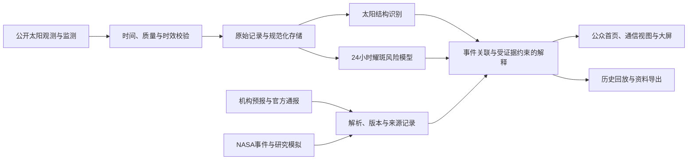

# MDVA 空间天气公众服务与通信风险辅助决策平台项目计划

日期：2026-11-11  
版本：讨论稿 v1.0  
用途：产品范围审核、毕业设计选题讨论、后续实施与验收依据。

本文件仅形成计划，不表示功能已交付。本轮仅新增本计划文档，不修改应用代码、原始数据或 GitHub 内容。此前讨论中的“仅建设识别标注、不开展预测”范围，按本次确认调整为“公众服务为产品主体，包含经过验证的太阳活动风险预测，融合外部权威预报”。

## 一、项目简介与产品定位

MDVA 拟建设一个面向公众、兼顾短波通信等实际业务需求的空间天气信息与辅助决策平台。系统自动获取公开太阳观测、空间环境监测、事件记录和机构预报，结合太阳结构识别与未来 24 小时耀斑风险模型，提供太阳现状、事件时间线、未来风险、通信影响解释以及有来源的日地传播可视化。

用户打开浏览器即可查看信息，无需准备数据集、绘制标注、训练模型或理解 AR/CH/FL 等缩写。已有数据集管理与标注工具转为开发维护后台，用于资料核查、训练数据准备和模型质量管理。

建议毕业设计题目：**《基于多源数据融合的空间天气监测与通信风险辅助决策平台设计与实现》**。

可选题目：**《融合太阳图像分析与权威预报的空间天气可视化服务平台设计与实现》**。

产品的主要工程工作包括多源采集、时间与质量检查、事件关联、来源追溯、模型服务、风险解释、可视化和移动端适配。识别模型作为支撑模块，预测结果和应用服务共同组成完整交付。

## 二、实际意义、目标用户与应用场景

### 2.1 需要解决的问题

1. 太阳观测、监测曲线、事件和预报分布在多个网站，用户难以统一查询。
2. 专业产品包含大量缩写、等级和时间定义，用户容易把观测事实、预测和研究模拟混为一谈。
3. 用户关心某项业务是否需要关注风险，专业图像本身不能直接回答这一问题。
4. 同一事件会有后续分析和预报修订，普通信息列表难以呈现其演化与依据。
5. 图像识别和预测方法缺少与真实使用流程的连接，难以评估系统是否帮助用户完成任务。

### 2.2 首轮应用边界

首个业务场景聚焦**短波通信风险信息查询与任务前准备**。用户可选择关注项，查看相关事件、自研 24 小时耀斑风险、机构三天展望、通报有效期与解释，并按本单位或个人已有流程复核备用通信安排。

太阳活动确实能影响短波传播，但影响与日照区域、电离层、频段和具体链路有关。风险模型不直接输出“某台设备必然故障”，也不自动替用户决定停工、停航或切换频率。业务依据来自 [NOAA 短波通信影响说明](https://www.spaceweather.gov/impacts/hf-radio-communications)和[空间天气等级说明](https://www.spaceweather.gov/noaa-scales-explanation)。

### 2.3 场景与交付结果

| 使用者与场景 | 用户任务 | 系统交付 | 实际价值 |
|---|---|---|---|
| 公众看到“强太阳风暴”新闻 | 查询事件是否存在、何时发生、信息是否仍有效 | 事件摘要、原始来源、时间线及已知影响说明 | 减少过时信息与笼统表述造成的误解 |
| 应急、海上作业等短波通信使用者进行任务前检查 | 查看未来关注时段及相关通报 | 自研 24 小时耀斑风险、机构三天预报、相关通信提示 | 将分散信息整理成可快速阅读的任务参考 |
| 通信人员回查异常时段 | 查看当时是否有相关太阳活动和官方通报 | 历史监测、事件及预报版本的关联视图 | 为排查提供背景证据，不单独认定故障原因 |
| 值班展示、课堂或答辩演示 | 一屏理解太阳现状、事件和后续变化 | 可视化大屏及可点击详情 | 明确呈现信息来源、演化过程与不确定性 |
| 开发维护人员 | 准备和核查模型数据 | 原有数据管理、标注、处理与导出后台 | 支撑模型维护，保留实验与数据可追溯性 |

卫星导航等影响查询可作为后续扩展。精确的本地导航误差或单条通信链路中断预测，需要额外的电离层、设备和业务数据，本期不作承诺。产品按普通用户可直接访问的方式设计，同时保留有明确需求的行业用户入口，不要求每一位用户每天都使用。

## 三、现有基础与当前完成情况

以下依据本地代码、2026-11-11 服务只读检查及已有验收记录，不将本地成果等同于 GitHub 默认分支状态。

| 模块 | 当前状态 | 本计划中的位置 |
|---|---|---|
| Python 启动器、本地 HTTP 服务、Vue 3/TypeScript、SQLite | 已有可运行基础 | 继续复用，首次环境检查服务于本机启动 |
| 数据集总览 | 已实现独立数据集入口、搜索排序；手动打开后分页浏览，默认每页 60 条 | 作为维护后台，不作为公众默认首页 |
| SSAFD 结构图像索引 | 已登记 13,548 张图像 | 识别训练、标注核查和历史资料基础 |
| 原始掩膜参考与 NOAA 对应 | 已有只读参考叠加、选择与关联查看 | 不混称为本平台模型识别结果 |
| 人工多边形编辑、保存和审核 | 已有实现与样本验证 | 用于训练资料维护与模型候选复核 |
| 清洗、增强、版本与导出 | 已有基础与样本工程验证 | 继续用于数据准备；原件保持只读 |
| 太阳科学工作台 | 已有页面和部分目录/事件索引代码 | 尚未完成多产品全量索引与完整验收 |
| 三类结构识别模型 | 未交付通过验证的太阳专用推理模型 | 需要公开基线核验、训练和测试 |
| 耀斑风险预测 | 未实现 | 需要独立样本构建、训练与概率评估 |
| 自动公开数据采集 | 尚未接入应用，仅完成来源核验和连接抽查 | 需要采集调度、缓存、质量与异常处理 |
| 权威预报、事件、CME 到达估计 | 接口已进行可行性核验，应用功能未完成 | 需要解析、关联、修订记录和展示 |
| 公众首页、通信关注视图、日地大屏、手机卡片 | 未完成 | 作为本轮产品主体新增 |

本次服务检查：三个本地数据源已登记；结构全量集有 13,548 条，90 张验收集独立存在。新建的多产品太阳目录接口仍返回图像、日期和事件数量为 0，不能称为“完整太阳产品已接入”。目录型旧数据集在列表返回的数量未统计，不据此认定为空。

此前工程验收验证过 AR/CH/FL 各 30 对样本的保存、审核、处理回退和导出回读；它不等于太阳模型效果验证。历史日志对 CH/FL 使用“实例”的旧口径需纠正，不把类别区域数当作物理对象数。

## 四、总体功能与使用流程

### 4.1 公众侧

1. **今日概览**：有效通报、信息更新时间、未来风险摘要和主要事件。
2. **影响查询**：选择短波通信等关注项，展示有依据的相关通报、适用时段和解释。
3. **太阳观测**：按观测类型查看图像；结构候选、原始参考、人工修订分别标识。
4. **事件中心**：按日期、类别查询事件，查看官方编号、来源、发生时间和分析更新。
5. **预报中心**：并列展示本平台 24 小时耀斑风险和机构未来三天预报。
6. **传播与到达**：查看有来源的 CME 分析、地球影响状态和预计到达信息。
7. **历史回放**：用统一演示时钟回看观测、通报和当时已发布的预报。
8. **手机视图**：提供风险、事件和更新卡片，避免把整个大屏等比例缩小。

第一版关注项偏好可以本地保存，不依赖账号体系。默认页面不向用户暴露工作区、训练任务、数据集路径和模型安装细节。

### 4.2 开发维护侧

保留数据集总览、导入预检、人工标注、质量检查、清洗增强、版本与导出。新增采集源健康状态、任务日志、模型版本、评估报告和内容发布记录。界面上的维护入口不是权限隔离；将来远程发布时必须另行实现访问控制。

### 4.3 总体数据流



图像识别结果、实验预测、机构预报与研究模拟不直接拼成一个无法解释的“总风险概率”。来源发生分歧时并列呈现，并说明适用时间及依据。

## 五、日常运行的数据来源与输入要求

### 5.1 图像输入

| 用途 | 目标输入 | 公开来源 | 缺测处理 |
|---|---|---|---|
| AR 活动区识别、磁图预测基线 | SDO/HMI 全日面视向磁图 | [SDO 数据获取](https://sdo.gsfc.nasa.gov/data/dataaccess.php) | 必需输入过期时暂停对应预测；保留历史结果及其有效期 |
| CH 冕洞识别 | SDO/AIA 193 Å 图像 | [SDO 最新图像](https://sdo.gsfc.nasa.gov/data/) | 此任务标记暂缺，不伪造结果 |
| FL 日面暗条识别 | Hα 线心全日面图像 | [NSO/GONG](https://nso.edu/data/nisp-data/h-alpha/)、[KSO 档案说明](https://www.kso.ac.at/beobachtungen/sonne_beobachtungen/about_halpha_en.php) | 切换已验证备用源；否则显示缺测 |
| 多模态预测扩展 | 与磁图时刻匹配的 AIA 304 Å 图像 | NASA SDO | 是否必需由实际训练的方法决定；不得随意用零值填补 |

SDO 浏览图可以用于显示；模型输入需要匹配训练时的产品、空间标准化、灰度映射和尺寸。科研 FITS 与展示 JPEG 的处理不同，不能混用。新的 Hα 台站即使波段相同，也需要验证域差异；不能认定由原数据中的 KSO/BBSO/HSOS 图像训练后就自动适用于所有 GONG 图像。

太阳结构识别展示三类观测；首轮耀斑预测可以选经过验证的磁图单模态方法，不强制等待三类图像同时齐全。若采用多模态方法，必须满足其具体输入条件。

### 5.2 监测、事件与预报

| 数据 | 官方查看入口 | 程序读取入口 | 性质与用途 |
|---|---|---|---|
| GOES X 射线通量 | [官方曲线](https://www.spaceweather.gov/products/goes-x-ray-flux) | [近一天 JSON](https://services.swpc.noaa.gov/json/goes/primary/xrays-1-day.json) | 已观测活动曲线及耀斑核查 |
| 上游太阳风速度与密度 | [太阳风页面](https://www.spaceweather.gov/products/solar-wind) | [RTSW wind](https://services.swpc.noaa.gov/json/rtsw/rtsw_wind_1m.json) | 太阳风扰动监测 |
| 行星际磁场 | 同上 | [RTSW mag](https://services.swpc.noaa.gov/json/rtsw/rtsw_mag_1m.json) | 磁场变化与近地环境背景 |
| 地磁活动指标 | [Kp 产品](https://www.spaceweather.gov/products/planetary-k-index) | [NOAA Kp 数据](https://services.swpc.noaa.gov/products/noaa-planetary-k-index.json) | 明确区分估计/观测与预测；保留产品原始定义 |
| 机构三天展望 | [三天预报](https://www.spaceweather.gov/products/3-day-forecast) | [原始文本](https://services.swpc.noaa.gov/text/3-day-forecast.txt) | 外部业务预报，保留发布时间和理由 |
| 警报、关注与预警 | [官方页面](https://www.spaceweather.gov/products/alerts-watches-and-warnings) | [alerts JSON](https://services.swpc.noaa.gov/products/alerts.json) | 通报有效期、类别、更新及取消状态 |
| 太阳事件 | [DONKI 事件](https://ccmc.gsfc.nasa.gov/DONKI/events/) | [DONKI API 文档](https://ccmc.gsfc.nasa.gov/DONKI/api/) | 事件、分析和来源关联 |
| CME 传播与到达信息 | [NOAA WSA–ENLIL](https://www.spaceweather.gov/products/wsa-enlil-solar-wind-prediction) | DONKI 的 WSAEnlilSimulations 公共服务 | NOAA 业务产品与 NASA 研究模拟分别标注 |
| 预测方法需要的 F10.7 等附加输入 | 对应机构说明 | [NOAA F10.7 数据](https://services.swpc.noaa.gov/json/f107_cm_flux.json) | 仅在所选基线明确需要且时效满足时使用 |

已验证的 DONKI 请求示例：

- [2026-11-01 至 2026-11-11 CME](https://ccmc.gsfc.nasa.gov/DONKI/WS/get/CME?startDate=2026-11-01&endDate=2026-11-11)
- [同一日期范围传播模拟](https://ccmc.gsfc.nasa.gov/DONKI/WS/get/WSAEnlilSimulations?startDate=2026-11-01&endDate=2026-11-11)

以上日期是查询示例，不表示返回的历史预报现在仍然有效。运行时按任务所需时间范围查询，保留原始结果和获取时间。

### 5.3 来源核验状态

2026-11-11 已进行官方资料核对和本机抽查：SDO 的 HMI/AIA193/AIA304、GOES X 射线、NOAA 三天预报、alerts、RTSW 新接口、F10.7、DONKI CME 和传播模拟均取得正常响应；KSO 档案目录可访问，抽查近期目录最新图像为 11 月 10 日；GONG 请求出现连接错误。它们是单次可行性检查，不是连续可用性验收。

NOAA 的旧太阳风地址本次返回 404，接入采用官方替代的 `/json/rtsw/` 数据，依据[官方迁移通知](https://www.weather.gov/media/notification/pdf_2026/scn26-21_Data_Format_Changes_Impacting_SWPC_Products.pdf)。DONKI 采用当前 `ccmc.gsfc.nasa.gov` 域名，依据[官方系统说明](https://ccmc.gsfc.nasa.gov/tools/DONKI/)。

国内权威公开信息后续评估接入；尚未核验的结构化接口不列为已经具备的稳定数据源。

### 5.4 采集与时效策略

- 建议图像每约 15 分钟检查更新，曲线和通报每约 5 分钟检查更新；尊重来源实际节奏、缓存机制和访问约束。这是轮询建议，不是对外部机构更新频率的承诺。
- 保存观测时间、产品发布时间、获取时间、预报起止时间和系统处理时间；内部统一 UTC，前端默认北京时间并允许查看 UTC。TAI 等时间标准须明确转换。
- 处理来源健康、重试退避、条件请求、重复数据、文件校验、单位和缺测标记。
- RTSW 按时间、来源、active 状态和质量标记筛选；列表顺序不作为“最新”依据。
- 图像近同时配对需规定允许时间差，显示实际时差；未经配准的图像不能直接套用另一通道的边界。
- 过期、来源不可达和真实低风险是三种不同状态。断网时展示带时间标识的缓存或历史回放，不将旧信息标为实时正常。

## 六、识别与预测的训练实施

### 6.1 已有训练资料

数据源为 **Solar Situation Awareness and Flare Forecasting Dataset for Operational Applications**，数据 DOI：[10.57760/sciencedb.space.03541](https://doi.org/10.57760/sciencedb.space.03541)，论文 DOI：[10.1038/s41597-026-08005-5](https://doi.org/10.1038/s41597-026-08005-5)。项目仓库与源码包不包含该原始数据集，需从官方单独下载；软件许可不替代数据集许可。

本地已有三个数据产品：

| 数据产品 | 本地核查情况 | 主要用途 |
|---|---|---|
| Situation Awareness Dataset | 13,548 张图像、11,968 份掩膜、11,914 对；1,634 张仅图像、54 份仅掩膜 | 三类结构识别与原始标注参考 |
| Standardized Solar Observation Image Dataset | 清点为 46,328 个图像文件；不同产品可能重复收录同一观测 | 补充通道、核对来源与标准化 |
| Solar Flare Forecasting Dataset | 参数、区域标签与事件表；已有清点为 4,288 份参数表，对应 4,308 份 AR 掩膜中的 20 份缺少参数表 | 预测样本构建、目标标签核查 |

文件数不是独立事件数或独立训练样本数。此前已完整下载的三块数据继续使用，新增工作重点是时间审计、样本关联、实时输入适配与必要的历史补充。

### 6.2 三类识别

1. 分别核对图像、掩膜、类别与标注来源。
2. AR 按原始实例信息处理；CH/FL 按原始类别区域处理，独立对象分组需另行验证。
3. 原始像素标注不可变；人工多边形为独立版本，其近似性质和孔洞差异明确记录。
4. 核验原团队方法及可获得的作者代码、权重与预处理条件，再确定可运行基线。
5. 开展同分布测试、跨台站/产品验证、错误案例复核，合格后才接入用户视图。

参考原团队 [SPNet/FPNet 方法](https://arxiv.org/html/2508.06892v1)、[CNN193 作者实现](https://github.com/observethesun/coronal_holes)、[CHRONNOS 作者实现](https://github.com/RobertJaro/MultiChannelCHDetection)和[Hα 暗条识别研究](https://arxiv.org/abs/2402.15407)。它们是待核验的方法依据，不是已选定或已经复现的全部模型。权重不可得时应明确区分自行训练、论文重建和本地适配，不宣称完整复现。

### 6.3 首轮预测任务

任务定义：**以有效观测时刻 T 的活动区样本为单位，预测未来 24 小时内是否发生 M 级及以上耀斑，并评估概率可信度。** 全日面风险若要提供，需单独定义目标和验证聚合方法，不能默认多个活动区独立并随意相加。

输入优先选择公开文献中能够复现的一套配置。磁图单模态预测有公开研究依据，见[24 小时磁图预测研究](https://arxiv.org/abs/2309.14483)；原团队 FPNet 的输入包含多种观测与附加信息，不能用简化输入冒充原实现。

每个样本应记录：观测/可获得时间、原图来源、活动区关联、输入预处理、过去信息的截止时刻、未来目标窗口、标签来源及标签完整性。

必须先核查预报目录中 flare index 和 C/M/X 标签的确切时间定义。使用未来事件生成的值仅作为标签；作为输入的历史活动指数必须只使用 T 之前的信息。没有事件记录也不自动等于负样本，要核对记录完整性。

将较早时期用于训练、中间时期用于验证、较晚时期用于独立测试；控制同一活动区、相邻预测窗口和同源副本造成的泄漏，具体时间切分与隔离带依据实际覆盖和 24 小时目标窗口确定。保留同一协议下的基准结果、误报、漏报和校准结果。

日级训练得到的模型先按日级协议发布预测；要提供小时级滚动预测，应补足相应历史采样与独立验证，不能仅缩短调度间隔。FITS 转出的 8 位 JPG 不用于反推定量磁通量；必要物理参数使用有来源的数值产品。

### 6.4 通信影响与预测范围

模型输出首先是太阳事件风险，通信影响由事件性质、有效时段、日照范围及公开业务规则等共同解释。缺少具体地区、频率和电离层数据时，仅给出适用范围内的潜在影响说明。自研实验概率不直接转换成某条链路中断概率。

未来三天展望先使用机构产品。CH 高速太阳风预测、暗条爆发预测以及自研 CME 到达预测暂不同时扩展；它们分别需要新的目标定义、时间序列、传播信息与真实验证标签。

## 七、事件关联、传播与到达信息

### 7.1 事件记录

保留来源原始编号、事件类别、发生时间、位置、强度、仪器、分析状态、关联编号、发布时间及修订记录。优先使用来源给出的事件关联；仅有“同一天发生”不能认定因果关系。无法确认的关联显示待核验。

界面区分日面暗条 FL 与事件目录中的耀斑 FLR，均使用中文全称，避免代码缩写造成混淆。

### 7.2 各类事件展示规则

| 类型 | 展示内容 | 到达时间规则 |
|---|---|---|
| 耀斑 | 开始、峰值、结束、等级、源区及观测依据 | 不统一设置“几天后到地球”倒计时 |
| CME | 观测事件、速度/方向等已有分析、传播模拟及目标 | 仅在模型明确给出地球到达估计时展示 |
| 高速太阳风 | 观测与有来源的预计影响时段 | 缺少预报不自行生成精确时刻 |
| 地磁活动 | Kp 等观测与机构预报 | 区分已经发生和预期活动，不画成一个飞向地球的物体 |

第一版不重建完整磁流体传播模型。使用 [NOAA WSA–ENLIL 产品](https://www.spaceweather.gov/products/wsa-enlil-solar-wind-prediction)及 [NASA DONKI 分析](https://ccmc.gsfc.nasa.gov/tools/DONKI/)支撑有来源的展示。DONKI 中研究模拟与 NOAA 业务预报分别标识。

### 7.3 到达状态机

状态至少包括：已发现、待分析、已有传播估计、当前模型未给地球到达估计、预计时刻已过待确认、观测确认到达、分析已修订。

- `estimatedShockArrivalTime` 等字段只是预计时刻，空值不等于零，也不自动等于已经排除风险。
- 检查模拟的目标是否为地球，不能使用其他行星或航天器的到达时刻代替。
- 提供来源明确给出的区间或不确定性；若未提供，不自行编造“±若干小时”。
- 预计时刻过后等待相应观测或分析确认；倒计时结束不自动触发“已到达”。
- 多次模拟可切换比较，默认采用有明确选择依据的有效版本，并保留旧版本。

## 八、数据如何展示

### 8.1 总览大屏布局

```text
┌────────────────────────────────────────────────────────────────────┐
│ 空间天气总览  观测/预报时间  最后同步时间  来源健康  实时/历史模式     │
├───────────────────┬──────────────────────────┬─────────────────────┤
│ 太阳多波段观测     │ 日地传播可视化           │ 相关通信通报        │
│ HMI / AIA / Hα     │ 太阳、地球、选中事件     │ 类别、范围、有效期  │
│ 结构候选与原图对照 │ 有数据支撑的传播示意     │ 影响解释与原文入口  │
├───────────────────┤                          ├─────────────────────┤
│ 自研24小时耀斑风险 │                          │ 机构未来三天展望    │
│ 模型版本及输入时效 │                          │ 独立标识机构与来源  │
├───────────────────┼──────────────────────────┼─────────────────────┤
│ GOES X射线曲线    │ 太阳风、磁场及地磁曲线   │ 事件与分析时间线    │
│ 耀斑时刻与等级     │ 图例、单位、观测时间     │ 发生/发布/预计到达  │
└───────────────────┴──────────────────────────┴─────────────────────┘
```

大屏中间的传播动画跟随选中事件和已有模型参数；仅有时间、方向或预计时刻时，展示明确标为“示意”的日地关系。没有真实轨迹数据不宣称精确三维传播路径；未分析事件不统一朝地球播放。

### 8.2 图像、曲线和事件联动

用户点击事件后，展示其来源页面、关联区域和可用观测。仅在位置、时刻和配准满足要求时叠加定位；否则提供独立图像对照，说明未配准。点击曲线峰值可定位相应时段与已确认事件，不把每个峰值都自动解释为已认定事件。

曲线可切换时间范围并显示缺测；降采样需保留峰值信息，避免将关键尖峰平滑掉。物理单位、观测源和时间范围必须可见。

### 8.3 用户首页与手机端

公众默认首页提供“发生了什么、我关注的事项、未来展望、证据来源”四类卡片；完整大屏作为可切换模式。手机页面将通报、风险和事件拆为纵向卡片，并可查看原文和时效，不显示后台数据集和训练参数。

### 8.4 信息标识规范

统一标识：**观测事实 / 本平台实验预测 / 机构业务预报 / 研究模拟 / 数据缺失或过期**。风险颜色依据已定义的业务规则或来源等级；未知状态使用独立样式，不用绿色代替未知。保留 R、S、G 的各自含义，不合成没有依据的“太阳风暴总分”。

未来 24 小时的概率和机构三天展望并列呈现，不相互覆盖。用户可查看计算依据、发布者、有效期及原始来源。提示文本优先使用可审核模板和已核验规则，通用问答模型不作为第一版必需组件。

## 九、功能实施与技术设计

沿用 Vue 3、TypeScript、Python 本地服务和 SQLite。拟新增采集适配器、调度与重试、原始记录缓存、规范化事件存储、模型推理服务和公众只读接口；可视化图表库在实施时评估。训练环境与日常服务环境隔离，浏览器不负责安装模型或直接携带私密凭据访问外部接口。

建议新增的持久化对象包括：数据源、获取任务、观测记录、质量状态、来源原始事件、规范化事件、事件关系证据、预报版本、传播模拟、模型版本、模型结果及展示解释。所有变换能追溯到原始记录。

解释层先使用领域词典、已核验规则和模板，将等级、时间、范围与原文逐项对应。后续如增加语言模型，只用于有证据的表述与检索辅助，必须回查原文，不能自行生成新的观测、预报或处置结论。

训练资源方面，本机已探测到 8 GB 显存的 RTX 5060；训练环境与 GPU 依赖尚需单独配置和验证。先选一套可复现基线开展小规模试训，记录显存、耗时和输入适配结果，再决定完整实验设置。不默认从头训练原团队的大型模型，也不在资源未实测前承诺固定训练时长。

第一轮先本机完成交付。公众服务的产品定位不等于直接把现有文件处理后台暴露到公网。后续若部署远程服务，需另行实施公开只读接口、管理认证、资源隔离和部署防护；不自动上传原始数据、发布站点或推送 GitHub。

## 十、分阶段实施计划

按里程碑推进。具体日历安排在数据连续性与基线可运行性检查后确定，避免在尚未实测前承诺训练周期。

| 阶段 | 实施任务 | 交付物 | 通过条件 |
|---|---|---|---|
| P0 范围与资料审计 | 固定用户任务、术语、数据来源、输入条件、标签时间定义 | 需求清单、来源矩阵、训练样本规范 | 自研与外部能力分工清晰，关键数据不明处有明确处理方案 |
| P1 自动采集与存储 | 接入 SDO、监测、预报、通报和 DONKI；缓存、质量、时效、重试与原文记录 | 可追溯数据管道及源健康页 | 建议连续 7 日检查；获取失败、过期和解析失败均可发现 |
| P2 公众页面与真实数据大屏 | 首页、曲线、事件、机构展望、传播信息、移动卡片、历史模式 | 不依赖假数据的可演示公众服务原型 | 每个展示值能回查来源；没有模型结果的区域明确未就绪 |
| P3 三类结构识别 | 公开基线核验、训练、独立测试和输入适配 | 推理模块、结果叠加与错误报告 | 完成分任务指标、跨来源验证与失败反馈 |
| P4 自研24小时预测 | 构建活动区时间样本、基线、概率校准与独立测试 | 预报模块、模型卡、评估及历史回放 | 相对基准的效果可检验，无时间泄漏；不合格模型不标为业务可用 |
| P5 通信场景与端到端联调 | 关注项筛选、规则解释、来源差异、预报修订、移动体验 | 完整任务流程与使用说明 | 代表用户能正确完成查询并区分信息性质 |
| P6 验收与论文材料 | 工程、模型、可用性、性能与异常场景验收 | 验收记录、演示案例、论文图表和交付包 | 缺陷有处理或明确限制，结果可重复核查 |

P2 可先交付机构信息服务，但不意味着自研模型任务已完成。最终计划包含 P3/P4；若实验结果达不到要求，应报告结果并调整模型可用状态，不用外部预报或随机数字冒充成功。

## 十一、验收与效果评价

### 11.1 数据与工程

- 样本检查时间、单位、数据源、缺测与原文映射；预报适用时段不得错配。
- 对事件更新、重复、取消、修订、来源冲突、接口字段变化进行验证。
- 断网或上游失败后保留历史可查性，并正确显示过期状态。
- 公众可见值和解释均有来源或模型版本；真实记录与演示资料清楚区分。
- 全部数据集原件只读，迁移与新表不破坏现有人工标注。

### 11.2 模型

- 识别按 AR/CH/FL 分别报告 IoU、Dice 和错误类型；有可靠对象真值时再报告对象级指标。
- 预测报告 Precision、Recall、误报漏报、PR 曲线、TSS/HSS、Brier Score/Brier Skill Score 和可靠性表现，不以准确率一项评价。
- 与同一时间划分下的简单基准及选定公开方法比较；具体指标门槛在基准实测后确定，不预先编造性能保证。
- 以仅使用当时可获得资料的方式回放预测，禁止事后更新的标签、参数或传播分析进入历史输入。
- 机构预报、NASA 模拟与本平台模型分别评估和署名；预计到达和实际到达分开核验。

### 11.3 用户与显示

用代表性任务评估“找到相关通报、辨认有效期、理解影响范围、区分预测来源、回查历史事件”的完成率、耗时和错误。可邀请 5—10 名代表性体验者进行初步测试，结果如实报告，不视作大规模用户结论。

建议本机已有缓存条件下，以首页主要信息约 2 秒内可用、普通查询接口 P95 约 1 秒内作为初步优化目标；外部获取延迟、模型推理和所有图像加载分别测量。它们是待测目标，不是已实现指标。

### 11.4 演示案例

1. 无明显异常时：展示有效机构信息，缺测与正常不混淆。
2. 历史耀斑：曲线、事件等级、观测时间和相关通报联动。
3. 有地球到达估计的 CME：展示当时模拟版本及后续修订、确认信息。
4. 无地球到达估计的 CME：无虚假倒计时。
5. 来源断开、Hα 缺测、预报过期：展示降级状态。
6. 自研预测与机构预报不同：显示差异和依据，不擅自合并概率。

## 十二、风险与处理

| 风险 | 处理方案 |
|---|---|
| 外部接口迁移或无法访问 | 适配器隔离、版本记录、备用来源、缓存和健康检查 |
| 地面 Hα 缺测或来源域差异 | 单独任务状态；只使用通过验证的备用源；不阻断不依赖 Hα 的预测 |
| 原团队代码/权重不可得 | 采用公开可复现方法或明确重建基线；记录适配差异 |
| 标签时序不清或未来泄漏 | 先审计标签和可获得时间；不能确认的样本不进入正式评估 |
| 强耀斑样本少、模型误报多 | 独立时间测试、概率校准、与基准比较；未达标保持实验状态 |
| 传播结果无地球到达时刻 | 明确空状态，使用已有模型说明，不编造补齐 |
| 专业信息被误解为设备必然故障 | 限定业务范围、保留有效期和来源，受证据约束解释 |
| 范围扩张导致毕业交付失控 | 首轮聚焦短波通信、三类识别、24小时耀斑预测和外部三天展望；其他模型后续评估 |

## 十三、交付清单与论文重点

最终交付：可启动网页、公众概览与手机视图、真实数据可视化大屏、数据采集与健康记录、事件和机构预报查询、三类识别与24小时预测模块及模型卡、历史回放、维护后台、来源清单、使用说明、评估报告、缺陷台账和演示资料。原始数据集和第三方模型权重是否可分发，分别按其许可处理，默认不随源码提交。

论文重点包括需求分析、信息与数据模型、多源数据获取与质量控制、事件关联与版本追溯、模型服务与评估、公众解释及可视化设计、工程与用户任务验证。既有方法、原始数据团队贡献与本平台工程改进清楚区分；新增界面或集成现有模型不自动构成算法创新。

计划的完成标准是：使用者能够打开产品、理解当前信息、查看未来风险及其来源、完成通信相关查询并回查事件依据；开发者能够重复验证数据和模型结果。
